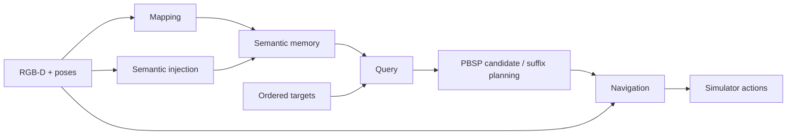

<div align="center">

# PBSP

**Persistent Belief-Aware Suffix Planning**

Online spatial memory and planning for ordered multi-object navigation.

[Data](#1-data) · [Installation](#2-installation) · [Run](#3-run) · [Components](docs/components.md) · [Runtime](docs/runtime.md) · [Validation](docs/migration.md) · [Citation](CITATION.cff)

[](LICENSE)

</div>

PBSP builds a persistent semantic Gaussian map from RGB-D observations, retrieves candidate locations for the remaining targets, and plans their ordered suffix before navigation. The map is shared across tasks within an episode. **2/3/4-MON use the same implementation and select their task sequences through configuration.**

<p align="center"></p>

Final map from the [recorded 4-MON episode](docs/validation/phase22_integration_results.json): 301 keyframes and 3,088,415 Gaussian points. The image header reports sampled points and CLIP feature coverage.



## 1. Data

```bash
git clone --branch refactor/full-pbsp https://github.com/pieceHk/PBSP.git
cd PBSP
```

Obtain the HM3D v0.1 validation scenes and semantic annotations from the [official provider](https://github.com/matterport/habitat-matterport-3dresearch#downloading-hm3d-v01), using the layout in the [data guide](docs/datasets.md#scene-assets). `scene_datasets/` must contain `hm3d/`. Then prepare all three fixed episode sets:

```bash
python3 scripts/prepare_data.py --scenes /path/to/scene_datasets
```

The script fetches the selected official ObjectNav annotations, rebuilds the released task sequences and checks every output hash. It creates `data/scenes/` and `data/episodes/`; [offline preparation](docs/datasets.md#offline-preparation) is also supported.

Prebuilt episode bundle (2/3/4-MON): `<DATASET_DOWNLOAD_URL>`.

| Experiment | Scenes | Episodes | Targets per episode | Total targets |
| --- | ---: | ---: | ---: | ---: |
| 2-MON | 20 | 600 | 2 | 1,200 |
| 3-MON | 20 | 400 | 3 | 1,200 |
| 4-MON | 20 | 300 | 4 | 1,200 |

The three sets share a fixed 1,200-target source pool selected using historical paired outcomes for controlled sequence-length comparisons. Each episode retains its ordered source identities; see [dataset scope and identity](docs/datasets.md#dataset-scope-and-identity).

## 2. Installation

Use separate Linux/CUDA environments for mapping and navigation:

| Environment | Python | PyTorch | CUDA build |
| --- | --- | --- | --- |
| Mapping | 3.10 | 2.7.1 | cu118 |
| Navigation | 3.9 | 2.1.2 | cu118 |

Validation used Ubuntu 20.04, GCC 9.4 and NVIDIA A40 GPUs. Install [micromamba](https://mamba.readthedocs.io/en/stable/installation/micromamba-installation.html), the CUDA 11.8 toolkit and the [system build dependencies](docs/navigation_installation.md). Then prepare both environments and resources:

```bash
python3 scripts/setup_envs.py --micromamba /path/to/micromamba \
  --cuda-home /usr/local/cuda-11.8
.cache/envs/navigation/bin/python scripts/prepare_models.py \
  --output Exp/assets/weights --zstd .cache/envs/mapping/bin/zstd
.cache/envs/navigation/bin/python scripts/prepare_runtime.py \
  --mapping-python .cache/envs/mapping/bin/python \
  --navigation-python .cache/envs/navigation/bin/python --weights Exp/assets/weights
```

This creates `.cache/envs/{mapping,navigation}`, prepares model assets and the pinned source dependencies, and writes data, weight, interpreter and GPU paths to `runtime.local.yaml`. See [installation details](docs/installation.md) or the [offline server workflow](docs/offline.md).

## 3. Run

From the repository root:

```bash
.cache/envs/navigation/bin/python run.py --config configs/experiments/hm3d_4mon.yaml --limit-episodes 1 --check
.cache/envs/navigation/bin/python run.py --config configs/experiments/hm3d_4mon.yaml
```

Select `hm3d_2mon.yaml` or `hm3d_3mon.yaml` for another dataset. GPU IDs live in `runtime.local.yaml`; `--gpus 0,1` overrides them for one run. Keep `--limit-episodes 1` and remove `--check` to run one complete ordered episode. `--scene <id> --episode <id>` selects an exact runtime identity.

Each run writes a new directory under the configured output root, normally `outputs/`:

```text
outputs/<run>/
├── status.json             # process completion
├── resolved_config.yaml    # effective experiment and model settings
├── launch.json             # selected identities and worker inputs
├── provenance.json         # code, devices and resource paths
├── model_manifest.json     # checked default model identities
├── logs/                   # mapping and navigation logs
└── mon_metrics.json        # SR, SPL, PSR and PeSPL
```

Per-episode metrics and candidate decisions live under scene result directories; final map images are in `artifacts/mapping_final/`. Worker exit records and logs accompany the results. See [runtime and outputs](docs/runtime.md) for lifecycle details, and [result summarization](docs/reproduction.md#recompute-and-compare) to recompute metrics, compare runs or merge completed shards.

## Components

| Part | Read the implementation | Replacement boundary |
| --- | --- | --- |
| Mapping | [mapper.py](pbsp/mapping/mapper.py), [encoder.py](pbsp/mapping/encoder.py) | RGB-D, poses and episode-local map state |
| Semantic injection | [features.py](pbsp/semantics/features.py), [SemanticInjector](pbsp/semantics/types.py) | Aligned features, codebook IDs and semantic state |
| Query | [engine.py](pbsp/query/engine.py), [SemanticQuery](pbsp/query/service.py) | Semantic index and matching text embeddings |
| Navigation | [navigator.py](pbsp/navigation/navigator.py), [NavigationBackend](pbsp/navigation/backends.py) | Sensor frame, world waypoint, local maps and action |

[PBSPAgent](pbsp/agent.py) owns candidate execution and verification; [Runner](experiments/runner.py) executes complete ordered episodes. [Shared method settings](configs/methods/full_pbsp.yaml) separate mapping, query, navigation and suffix parameters. Experiment presets live in [configs/experiments](configs/experiments).

The [component guide](docs/components.md) explains how to replace a component and which interfaces a VLFM or ApexNav adapter must supply. Their full navigation stacks are future integrations; the default backend uses LagMemo.

## Validation and provenance

The [validation records](docs/migration.md) include frozen-code replays, Linux tests and complete single-episode runs using independently built mapping and navigation environments. The public offline installer has also created both environments from an empty directory; 50 mapping tensors and 21 navigation/Habitat tensors match their references exactly. A 6.61 GB offline bundle also passed code, environment-input and episode restoration checks with networking disabled; see the [offline restoration record](docs/validation/phase31_offline_export_results.json). Public model-download validation and full selected-split evaluation remain in progress. Historical branches and tags are documented in [versions and results](docs/versions.md).

PBSP-authored code uses the [MIT license](LICENSE). Adapted code, dependencies, datasets and weights retain their respective licenses; see [third-party notices](THIRD_PARTY_NOTICES.md). Mapping derives from [EmbodiedSplat](https://github.com/0nandon/EmbodiedSplat), and the default navigation backend derives from LagMemo.
