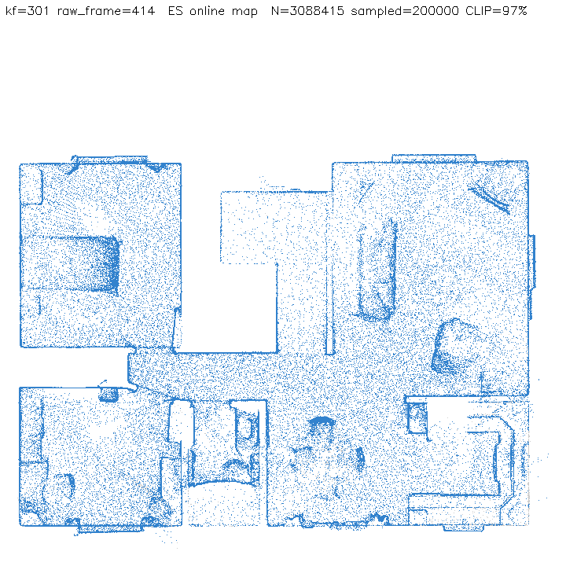
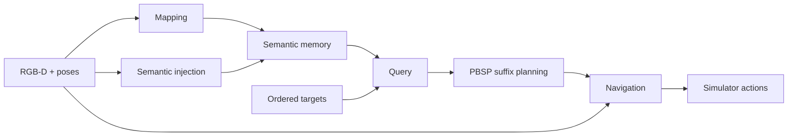

<div align="center">

# PBSP

**Persistent Belief-Aware Suffix Planning**

Online spatial memory and planning for ordered multi-object navigation.

[Data](#1-data) · [Installation](#2-installation) · [Run](#3-run) · [Code](pbsp/README.md) · [Citation](CITATION.cff)

[](LICENSE)

</div>

PBSP builds a semantic Gaussian map from RGB-D observations, retrieves candidate locations for the remaining targets, and plans their ordered suffix before navigation. Tasks within an episode share the map. **2/3/4-MON use the same implementation, selected through configuration.**

<p align="center"></p>



## 1. Data

Preparation commands use Python 3.9 or newer.

```bash
git clone --branch refactor/full-pbsp https://github.com/pieceHk/PBSP.git
cd PBSP
```

Obtain the HM3D v0.1 validation scenes and semantic annotations from the [official provider](https://github.com/matterport/habitat-matterport-3dresearch#downloading-hm3d-v01). Pass the directory containing `hm3d/` to:

```bash
python3 prepare.py data --scenes /path/to/scene_datasets
```

This prepares `data/scenes/` and the three episode sets under `data/episodes/`. See [data layout and offline preparation](data/README.md). Prebuilt episode bundle: `<DATASET_DOWNLOAD_URL>`.

| Experiment | Scenes | Episodes | Targets per episode |
| --- | ---: | ---: | ---: |
| 2-MON | 20 | 600 | 2 |
| 3-MON | 20 | 400 | 3 |
| 4-MON | 20 | 300 | 4 |

The sets share a fixed 1,200-target pool selected using historical paired outcomes for controlled sequence-length comparisons. Source identities and task order are preserved; see [dataset scope](data/README.md#scope-and-identity).

## 2. Installation

Use Linux x86_64, a CUDA 11.8 toolkit and [micromamba](https://mamba.readthedocs.io/en/stable/installation/micromamba-installation.html). System packages and fixed environment inputs are listed in [configs](configs/README.md).

Environments are installed outside the checkout in `~/.local/share/pbsp/envs/`; downloaded installation files are cached in `~/.cache/pbsp/`.

| Environment | Python | PyTorch | CUDA build |
| --- | --- | --- | --- |
| Mapping | 3.10 | 2.7.1 | cu118 |
| Navigation | 3.9 | 2.1.2 | cu118 |

```bash
python3 prepare.py envs --micromamba /path/to/micromamba --cuda-home /usr/local/cuda-11.8
"$HOME/.local/share/pbsp/envs/navigation/bin/python" prepare.py models --zstd "$HOME/.local/share/pbsp/envs/mapping/bin/zstd"
"$HOME/.local/share/pbsp/envs/navigation/bin/python" prepare.py runtime \
  --mapping-python "$HOME/.local/share/pbsp/envs/mapping/bin/python" \
  --navigation-python "$HOME/.local/share/pbsp/envs/navigation/bin/python"
```

Weights go to `third_party/weights/`. The last command prepares the pinned runtime dependencies and writes `runtime.local.yaml` with data, weights, output, interpreter and GPU paths. Existing weights and offline servers are supported through [local resource import](third_party/README.md#offline-preparation).

## 3. Run

Run one complete ordered episode:

```bash
"$HOME/.local/share/pbsp/envs/navigation/bin/python" run.py --config configs/experiments/hm3d_4mon.yaml --limit-episodes 1
```

Use `hm3d_2mon.yaml` or `hm3d_3mon.yaml` for another experiment. Remove `--limit-episodes 1` to evaluate the full selected set. `--scene <id> --episode <id>` selects an exact episode; `--gpus 0,1` overrides the mapping and navigation GPU IDs. `--check` validates inputs without starting workers.

Results are written to `experiments/runs/<run>/`: `mon_metrics.json` contains SR, SPL, PSR and PeSPL; `logs/` contains worker logs; scene directories contain trajectories and candidate decisions. Final map images are in `artifacts/mapping_final/`. See [results and summarization](experiments/README.md).

## Code

```text
pbsp/          Algorithm, component adapters and process runtime
configs/       Experiment presets, environment locks and resource manifests
third_party/   Required inference components and local model weights
data/          Scene and episode data
experiments/   Evaluation, preparation tools and generated results
run.py         Experiment entry
prepare.py     Data, environment and resource preparation entry
```

| Component | Implementation | Replacement boundary |
| --- | --- | --- |
| Mapping | [mapper.py](pbsp/mapping/mapper.py), [encoder.py](pbsp/mapping/encoder.py) | RGB-D, poses and episode-local map state |
| Semantic injection | [features.py](pbsp/semantics/features.py), [types.py](pbsp/semantics/types.py) | Aligned features and semantic state |
| Query | [engine.py](pbsp/query/engine.py), [service.py](pbsp/query/service.py) | Semantic index and matching text embeddings |
| Navigation | [navigator.py](pbsp/navigation/navigator.py), [backends.py](pbsp/navigation/backends.py) | Sensor frame, world waypoint and action |

[Agent](pbsp/agent.py) owns PBSP planning and target verification. [Runner](experiments/runner.py) executes and evaluates complete ordered episodes. The [component guide](pbsp/README.md) describes navigation replacement, including VLFM and ApexNav adapter requirements.

A complete 4-MON episode and clean-checkout preparation checks passed. The [reproduction record](experiments/reproduction.json) includes the source revision, checked identities and metrics.

PBSP-authored code uses the [MIT license](LICENSE). Adapted code, dependencies, data and weights retain their respective licenses; see [third-party notices](THIRD_PARTY_NOTICES.md).
