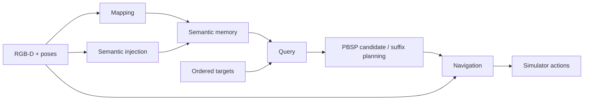

<div align="center">

# PBSP

**Persistent Belief-Aware Suffix Planning**

Online spatial memory and planning for ordered multi-object navigation.

[Data](#1-data) · [Installation](#2-installation) · [Run](#3-run) · [Components](docs/components.md) · [Validation](docs/migration.md)

[](LICENSE)

</div>

PBSP builds a persistent semantic Gaussian map from RGB-D observations, retrieves candidate locations for the remaining targets, and plans their ordered suffix before navigation. The map is shared across tasks within an episode. **2/3/4-MON use the same implementation and select their task sequences through configuration.**



## 1. Data

Prepare HM3Dv1 scenes and the ordered episode datasets below. The [data guide](docs/datasets.md) gives the directory layout, source requirements and identity checks; exact versions and checksums are in [assets/datasets.json](assets/datasets.json).

| Experiment | Scenes | Episodes | Targets per episode | Total targets |
| --- | ---: | ---: | ---: | ---: |
| 2-MON | 20 | 600 | 2 | 1,200 |
| 3-MON | 20 | 400 | 3 | 1,200 |
| 4-MON | 20 | 300 | 4 | 1,200 |

Each episode includes its ordered source identities. Preserve `scene_id`, `episode_id` and task order when preparing or replacing a dataset.

## 2. Installation

```bash
git clone --branch refactor/full-pbsp https://github.com/pieceHk/PBSP.git
cd PBSP
```

Use separate Linux/CUDA environments for mapping and navigation:

| Environment | Python | PyTorch | CUDA build |
| --- | --- | --- | --- |
| Mapping | 3.10 | 2.7.1 | cu118 |
| Navigation | 3.9 | 2.1.2 | cu118 |

Follow [environment and model preparation](docs/installation.md), then install PBSP in both environments with `python -m pip install -e .`. The preparation command records interpreter paths, connects data and weights, and checks the pinned Habitat dependency.

## 3. Run

From the repository root, with the navigation environment activated:

```bash
python Exp/scripts/run_full_pbsp.py --mon 4 --scope smoke --check-only
python Exp/scripts/run_full_pbsp.py --mon 4 --scope full --gpus 0,1
```

`--mon 2` or `--mon 3` selects another dataset. GPU order is **mapping,navigation**. Use `--scope smoke` to run one complete ordered episode before a full split.

Each run writes a new directory under `Exp/runs/`:

```text
Exp/runs/<run>/
├── status.json             # process completion
├── provenance.json         # code, configuration and data identity
├── logs/                   # mapping and navigation logs
└── mon_metrics.json        # SR, SPL, PSR and PeSPL
```

Per-episode metrics, candidate decisions and final map images live under the scene result directories. See [reproduction and outputs](Exp/release/LOCAL_REPRODUCTION.md) for deterministic scene/episode ranges and detailed artifacts.

## Components

| Part | Read the implementation | Replacement boundary |
| --- | --- | --- |
| Mapping | [mapper.py](pbsp/mapping/mapper.py), [encoder.py](pbsp/mapping/encoder.py) | RGB-D, poses and episode-local map state |
| Semantic injection | [features.py](pbsp/semantics/features.py), [SemanticInjector](pbsp/semantics/types.py) | Aligned features, codebook IDs and semantic state |
| Query | [engine.py](pbsp/query/engine.py), [SemanticQuery](pbsp/query/service.py) | Semantic index and matching text embeddings |
| Navigation | [navigator.py](pbsp/navigation/navigator.py), [NavigationBackend](pbsp/navigation/backends.py) | Sensor frame, world waypoint, local maps and action |

[PBSPAgent](pbsp/agent.py) owns candidate execution and verification; [Runner](experiments/runner.py) executes complete ordered episodes. [Shared method settings](configs/methods/full_pbsp.yaml) separate mapping, query, navigation and suffix parameters. Experiment presets live in [configs/experiments](configs/experiments).

The [component guide](docs/components.md) explains how to replace a component and which interfaces a VLFM or ApexNav adapter must supply. Their full navigation stacks are future integrations; the default backend uses LagMemo.

## Validation and provenance

The [validation records](docs/migration.md) include frozen-code replays, Linux tests and complete single-episode runs. Full selected-split evaluation and fresh-environment installation remain in progress. Historical branches and tags are documented in [versions and results](docs/versions.md).

PBSP-authored code uses the [MIT license](LICENSE). Adapted code, dependencies, datasets and weights retain their respective licenses; see [third-party notices](THIRD_PARTY_NOTICES.md). Mapping derives from [EmbodiedSplat](https://github.com/0nandon/EmbodiedSplat), and the default navigation backend derives from LagMemo.
