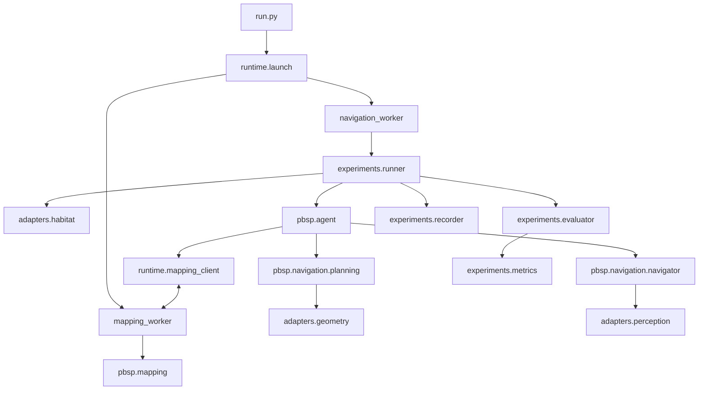

# PBSP 开源架构设计

以 `full-pbsp` 的在线建图、候选证据、候选重排、顺序后缀规划和导航执行为主体，整理成一个可阅读、可安装、可复现实验的项目。2/3/4-MON 共用同一套实现，通过配置选择数据集。本文定义目标目录和接口，实现进度见[迁移记录](migration.md)，四部分的当前接入方式见[组件接口](components.md)。

## 1 设计边界

四项要求都应落实到代码边界上：实验选择与算法分离；建图和导航的实际实现位于浅层目录；README 按数据、环境、运行组织；根目录提供统一入口。

full-pbsp 原始目录中的职责分布如下：

- `Mapping/src/tdonav_mapping/` 主要是接口和小型策略，实际在线建图在 `Mapping/runtime/server/online_es_mapper.py`，神经网络实现位于 `Mapping/runtime/embodied_splat/src/`。
- `Navigation/src/tdonav_navigation/` 已有较独立的证据、排序和后缀规划模块；实际动作执行仍在深层的 `glue_agent.py`。
- `Navigation/runtime/evaluators/goat/entrypoint.py` 同时承担数据身份读取、候选刷新、测地距离、规划分派、动作循环、评测和结果输出。
- 当前 `run_full_pbsp.py` 继续调用历史启动链。新入口应直接组装新模块。

此次重构保持 `full-pbsp` 的算法和实验协议。算法改进另设配置和变更记录，便于比较重构前后的行为。

## 2 目标目录

```text
PBSP/
├── README.md
├── run.py                         # 唯一实验启动入口
├── pyproject.toml
├── LICENSE                        # 项目许可证
├── CITATION.cff
├── THIRD_PARTY_NOTICES.md
│
├── pbsp/                          # 算法主体
│   ├── __init__.py                 # 保持轻量，导入时不加载模型
│   ├── agent.py                   # PBSP 完整算法流程
│   ├── types.py                   # 观测、任务身份、候选批次、动作等公共类型
│   ├── settings.py                # 显式的算法参数类型
│   ├── mapping/
│   │   ├── mapper.py              # 在线建图生命周期和异步更新
│   │   ├── keyframes.py           # 关键帧接纳与缓存
│   │   ├── geometry.py            # 相机、地图、Habitat 坐标变换
│   │   ├── memory.py              # 融合状态、地图快照与版本发布
│   │   ├── model.py               # 网络构建、权重加载、推理调用
│   │   ├── encoder.py             # 在线编码和增量特征更新
│   │   ├── fusion.py              # Gaussian 融合实现
│   │   ├── gaussians.py           # Gaussian 数据及批量操作
│   │   └── types.py               # 建图输入、快照和查询端口
│   ├── semantics/
│   │   ├── features.py            # 区域特征提取与语义码本注入
│   │   └── types.py               # SemanticInjector / SemanticInjection
│   ├── query/
│   │   ├── engine.py              # 语义检索、支持度、空间 NMS
│   │   ├── service.py             # 组装文本编码器与索引读取器
│   │   └── types.py               # SemanticIndex / FeatureSpace / QueryBackend
│   └── navigation/
│       ├── navigator.py           # 目标执行、局部地图和动作生成
│       ├── backends.py            # NavigationBackend 与 waypoint 控制接口
│       ├── planning.py            # 组织候选刷新、排序和计划分派
│       ├── candidates.py          # 候选记录、投影结果和距离状态
│       ├── evidence.py            # 跨帧候选证据与空间轨迹
│       ├── ranking.py             # 候选效用计算
│       ├── suffix.py              # 剩余有序任务的后缀规划
│       ├── cooldown.py            # 类别相关的目标切换控制
│       ├── verification.py        # 目标验证及多帧证据
│       ├── recovery.py            # 受困检测与恢复
│       └── local_planner.py       # 当前导航器所用的底层路径规划
│
├── adapters/                      # 外部系统的边界
│   ├── habitat.py                 # Habitat 环境、观测和动作转换
│   ├── geometry.py                # 导航网格投影、测地距离和可达性查询
│   ├── perception.py              # 组织实际使用的感知模型
│   ├── embodied_splat_semantics.py # 语义模型资源适配
│   ├── embodied_splat_query.py     # Gaussian 状态到通用语义索引
│   ├── detic.py
│   ├── seem.py
│   └── matching.py                # 当前流程实际调用的图像匹配与验证模型
│
├── runtime/                       # 进程与资源管理
│   ├── launch.py                  # 启动、等待、监控和回收工作进程
│   ├── config.py                  # 读取、校验、解析配置和资源路径
│   ├── mapping_worker.py          # 建图进程入口
│   ├── navigation_worker.py       # 导航与实验执行进程入口
│   ├── mapping_client.py          # 远程 Mapper 接口
│   └── protocol.py                # 工作进程间消息和序列化
│
├── experiments/                   # 运行和评价实验
│   ├── runner.py                  # 遍历 scene、episode 和有序任务
│   ├── dataset.py                 # 读取运行数据及完整身份索引
│   ├── evaluator.py               # 真值查询、成功判定和距离记录
│   ├── metrics.py                 # SR、SPL、PSR、PeSPL
│   ├── recorder.py                # 结果、轨迹、决策和时间统计
│   └── visualization.py           # 导航过程及建图可视化
│
├── configs/
│   ├── methods/full_pbsp.yaml     # 共享的完整算法参数
│   ├── datasets/hm3d_2mon.yaml
│   ├── datasets/hm3d_3mon.yaml
│   ├── datasets/hm3d_4mon.yaml
│   ├── evaluation/standard.yaml   # 评测预算、指标和记录选项
│   ├── experiments/hm3d_2mon.yaml
│   ├── experiments/hm3d_3mon.yaml
│   ├── experiments/hm3d_4mon.yaml
│   └── runtime.example.yaml       # 机器路径、解释器和 GPU 示例
│
├── scripts/
│   ├── prepare_data.py            # 检查数据，生成路径与身份索引
│   ├── setup_envs.py              # 创建两个环境并安装固定依赖
│   ├── prepare_models.py          # 下载或从本地缓存导入权重
│   ├── check_install.py           # 验证导入、模型加载与模拟器
│   ├── export_offline.py          # 导出代码、依赖和权重缓存清单
│   └── summarize.py               # 汇总已有实验结果
│
├── envs/
│   ├── mapping/                  # requirements、Conda 显式锁、完整 JSON 构建锁
│   └── navigation/               # requirements、Conda 显式锁、完整 JSON 构建锁
├── third_party/
│   └── licenses/                 # 外部代码许可证；来源索引见 THIRD_PARTY_NOTICES.md
├── assets/
│   ├── datasets.json              # 标准库可读取的数据版本、来源及校验值
│   ├── models.json                # 权重、配置、元数据及校验值
│   └── superglue.json             # 固定推理源码及补丁后的校验值
├── docs/
│   ├── architecture.md
│   ├── datasets.md
│   ├── installation.md
│   ├── reproduction.md
│   └── offline.md
├── tests/
│   ├── mapping/
│   ├── navigation/
│   ├── experiments/
│   ├── replay/
│   └── integration/
├── data/                          # 忽略内容，只跟踪目录说明
├── weights/                       # 忽略内容
├── outputs/                       # 忽略内容
├── .cache/                        # 忽略内容
└── runtime.local.yaml             # 准备脚本生成，忽略内容
```

目录树省略各 Python 包常规的 `__init__.py` 和兼容入口。`pyproject.toml` 声明 PBSP 包及公共依赖；两个环境的具体版本、源代码 revision、构建输入和校验值位于 `envs/<role>/linux-64.lock.json`。

建图从 `pbsp/mapping/mapper.py` 开始读，导航从 `pbsp/navigation/planning.py` 和 `navigator.py` 开始读，完整方法从 `pbsp/agent.py` 开始读。正常阅读无需进入旧仓库名称和多层 `src` 目录。

`mapper.py`、`encoder.py`、`fusion.py` 包含实际在线更新与融合实现，PBSP 的检索、规划和验证也位于上述浅层模块。EmbodiedSplat 的基础网络层与 Gaussian 渲染器保留在 `Mapping/runtime/embodied_splat/src/model/`，由 `adapters/embodied_splat.py` 构建；它们沿用原有 checkpoint 键和来源说明。Detic、SEEM 等推理依赖保留在 `Navigation/runtime/lagmemo/`；Habitat 和 SuperGlue 源码按清单准备到 `Exp/assets/dependencies/`。所有保留目录的用途和许可证见 `THIRD_PARTY_NOTICES.md`，可下载依赖由环境 JSON 锁和 `assets/superglue.json` 固定。

## 3 模块依赖与运行流程



核心模块接收对象和参数。`pbsp/` 不导入 `experiments/`、不解析命令行、不读取实验目录，也不通过环境变量选择算法。`agent.py` 只依赖传入的 Mapper、感知和几何查询接口；组装具体实现的工作交给工作进程入口。

一次 episode 的运行顺序为：

1. Runner 读取 episode、顺序任务和身份索引，建立 Habitat 场景。
2. Agent 和 Mapper 重置 episode 状态。
3. 每步将 RGB、深度、相机参数和位姿送入 Mapper；Mapper 接纳关键帧，异步重建并发布地图版本。
4. 按既定刷新节奏查询当前及后续任务的候选点，更新证据和基础排序。
5. 几何接口投影候选点并构建测地距离矩阵，后缀规划返回当前任务的候选顺序。
6. Navigator 执行目标，感知模块提供验证信息，恢复模块处理受困状态。
7. 目标验证完成或任务步数预算耗尽后，Runner 进入下一个任务，记录评测结果。
8. 所有任务结束后，导出 episode 结果，释放该 episode 的资源。

同一 episode 的子任务共享地图和空间记忆。切换任务只清理该任务的执行和验证状态；新 episode 才清理整份地图。剩余任务以 `episode.tasks[current_task:]` 表达，核心流程自然处理不同任务数量。

## 4 核心接口与状态所有权

以下是模块的目标接口，具体字段沿用当前实现中已验证的语义。

```python
class Mapper:
    def reset_episode(self, identity): ...
    def observe(self, observation): ...
    def query(self, tasks) -> CandidateBatch: ...
    def status(self) -> MapStatus: ...
    def finish_episode(self): ...
    def close(self): ...

class PBSPAgent:
    def reset_episode(self, identity, tasks): ...
    def start_task(self, task_index): ...
    def act(self, observation) -> AgentDecision: ...
    def finish_task(self, reason): ...
    def finish_episode(self): ...
    def close(self): ...

def plan_ordered_suffix(
    candidate_batch, current_task, ranked_layers, geodesic_matrices, settings
) -> SuffixPlan: ...
```

Mapper 的本地实现和跨进程客户端遵循同一个接口。网络和 IPC 细节由工作进程处理。后缀规划继续保持纯计算，输入候选和测地距离，输出排序及明确的回退原因。

| 状态 | 持有者 | 清理时机 |
| --- | --- | --- |
| 关键帧、增量特征、Gaussian 地图和地图版本 | Mapper | episode 结束或重置 |
| 任务相关候选证据和访问历史 | 候选规划模块 | 按当前 full-pbsp 的任务与 episode 生命周期 |
| 当前目标、局部路径、受困与验证状态 | Navigator | 切换任务时清理任务状态 |
| 当前任务索引、步数预算、样本范围 | Runner | 切换任务或 episode |
| 真值目标、成功判定、指标累计 | Evaluator | episode 结束后汇总 |
| 日志句柄、输出目录、可视化 | Recorder | run 结束 |

公共数据至少明确以下内容：

- `EpisodeIdentity`：数据版本、`scene_id`、运行 `episode_id`、有序 `source_episode_ids`、有序类别。重复类别通过任务索引区分。
- `CameraObservation`：RGB、深度、内参、位姿、帧号及 episode 身份。单位、轴方向和变换方向在类型注释中写清。
- `MapVersion`：episode 身份、已融合关键帧版本和查询序号。收到帧数与完成融合的版本分别记录。
- `CandidateBatch`：查询版本、任务索引、候选 ID、世界坐标、语义分数、支持度和已有证据。
- `GeodesicDistance`：距离及 `available`、`unreachable`、`unavailable` 状态。
- `AgentDecision`：动作、当前候选、验证状态、任务结束原因及计划版本。

地图查询结果按快照发布，分派前复查版本，保留已有的过期结果处理和回退语义。任务身份及候选版本贯穿查询、规划和记录。

几何接口集中实现当前使用的坐标变换、导航网格投影、同层约束和可达性查询。后缀规划继续使用严格测地距离。跨楼层、不可达和查询失败的处理保持可观察，实验协议中的 episode 列表保持原样。

Evaluator 单独持有成功标签和真值目标。Agent 获得任务查询、传感器观测及当前协议允许的几何信息；评测结果不参与候选排序。当前 `source_trace.json` 中的历史 outcome 字段也不进入运行身份索引。

## 5 配置如何拆分

| 配置 | 回答的问题 | 示例 |
| --- | --- | --- |
| Method | 方法怎样工作 | 独立的 mapping、query、navigation 与 suffix 参数 |
| Dataset | 在哪些样本上运行 | 数据版本、split、manifest、身份索引、预期任务数 |
| Evaluation | 怎样执行和评价 | 每任务 500 步、指标、输出和可视化选项 |
| Experiment | 采用哪组组合 | method、dataset、evaluation、随机种子 |
| Runtime | 在哪台机器上运行 | 数据根目录、权重根目录、解释器、GPU、输出路径 |

`configs/experiments/hm3d_4mon.yaml`：

```yaml
name: hm3d_4mon_full_pbsp
method: ../methods/full_pbsp.yaml
dataset: ../datasets/hm3d_4mon.yaml
evaluation: ../evaluation/standard.yaml
seed: 1
```

`configs/datasets/hm3d_4mon.yaml`：

```yaml
name: hm3dv1_4mon_balanced1200
split: val
root: episodes/hm3dv1/4mon
manifest: dataset_manifest.json
identities: identities.json
expected_tasks_per_episode: 4
```

`configs/methods/full_pbsp.yaml` 中包含整套生效参数，下面展示主要字段：

```yaml
name: full_pbsp
mapping:
  keyframe_threshold: 0.30
  warmup_keyframes: 10
  rebuild_interval: 10
query:
  top_k: 10
navigation:
  semantic_source: detic
  query_refresh_cadence_steps: 10
  candidate_evidence_ranking: true
  two_stage_verification: true
  frontier_rerank_enabled: false
  approach_ring: false
  candidate_exhaustion_exploration: false
suffix:
  mode: ordered_suffix_mvp
  candidate_cap: 5
  suffix_weight: 0.35
  strict_geodesic: true
  euclidean_fallback: false
```

正式迁移应把当前 profile 的其余权重、阈值、冷却配置和生效默认值全部显式整理进去。模型结构配置也要解析并保存，避免遗留 Hydra override 或 Python 默认值改变行为。

`configs/evaluation/standard.yaml` 明确评测预算和记录选项：

```yaml
max_steps_per_task: 500
metrics: [SR, SPL, PSR, PeSPL]
record_decisions: true
visualize: false
```

2-MON 和 3-MON 的 experiment 文件只修改名称和 dataset 引用，仍引用同一个 `full_pbsp.yaml` 和 `standard.yaml`。`expected_tasks_per_episode` 用于检查数据，算法根据实际任务列表运行。历史 2-MON、3-MON 分支作为来源版本记录；配置切换始终使用这次整理的同一套 full-pbsp 实现。

消融实验新增 method 配置，例如明确关闭后缀规划，并与完整方法配置生成可查看的参数差异。消融通过策略选择或参数注入生效，核心代码不读取实验名称。

配置解析采用一个小型、明确的加载器：

1. 读取 experiment 文件，再读取其直接引用的 method、dataset、evaluation。
2. 配置文件引用相对当前配置文件解析；数据和权重路径相对 Runtime 指定的根目录解析。
3. 读取 `runtime.local.yaml`；命令行只覆盖明确支持的 GPU 和样本范围等字段。
4. 校验字段和类型，输出展开后的完整配置，再创建工作进程。

每项算法参数只有一个配置来源。已解析的参数通过构造函数传入模块。兼容外部库所需的环境变量和路径设置集中在工作进程入口，并记录到运行信息中。

## 6 数据与模型资源

```text
data/
├── scenes/hm3dv1/                 # 连接实际场景资源，保留其内部目录
└── episodes/hm3dv1/
    ├── 2mon/
    │   ├── dataset_manifest.json
    │   ├── source_trace.json
    │   ├── identities.json        # 准备脚本生成的完整身份索引
    │   ├── content/*.json.gz
    │   └── val_seen.json.gz
    ├── 3mon/
    └── 4mon/

weights/
├── embodiedsplat/
├── detic/
├── seem/
├── mobileclip/
├── fastsam/
├── maskadapter/
├── matching/
└── hf_cache/
```

数据准备保留原始发布文件及其校验值，在旁边生成完整身份索引。运行数据分别包含 600 个 2-MON、400 个 3-MON、300 个 4-MON episode，每组均为 20 个 scene、1,200 个目标。

`prepare_data.py` 使用 Python 标准库，完成路径连接、manifest 和内容校验、任务顺序检查及身份索引生成，因而可以放在环境安装之前执行。完整 identity 索引统一覆盖全部 episode，运行时从当前数据读取身份；历史固定 48 条 identity 的来源记录保存在迁移记录中。

发布资源包含三组固定 episode 元数据包，以及原始选样计划和来源池记录。准备脚本从官方 ObjectNav 归档读取指定验证文件，按固定源索引和任务顺序重建全部 60 个场景文件，并逐一核对原实验文件的 SHA-256。README 给出 HM3D v0.1 场景获取入口和一行准备命令；`docs/datasets.md` 说明格式、类别别名、离线流程及历史结果校准的选样范围。重新采样属于独立工具，不参与复现已有实验。

模型清单同时记录 checkpoint、结构配置、类别元数据和必要缓存。`prepare_models.py` 支持网络下载及 `--cache` 本地导入，两者检查同一份清单，运行时从 `weights/` 读取资源。

## 7 环境与进程

保留独立的建图环境和导航环境。现有运行环境分别使用 Python 3.10 / PyTorch 2.7.1，以及 Python 3.9 / PyTorch 2.1.2；将两套模型强行装进一个环境会额外引入兼容性工作。

`setup_envs.py` 依据两份 Linux 依赖锁创建独立的 mapping、navigation 环境，安装项目、固定外部源码并构建需要的 CUDA 扩展。构建参数、编译器和 CUDA 工具链写入安装清单。Habitat 使用已验证 fork 的固定 revision `8df2661e5b2203c0ddc47798d5da0132d5686bbe`；来源由 navigation lock 管理，SuperGlue 的六个外部文件由该 lock 引用的源码清单固定。

安装脚本生成 `runtime.local.yaml`：

```yaml
paths:
  data: ./data
  weights: ./weights
  outputs: ./outputs
python:
  mapping: /path/to/envs/pbsp-map/bin/python
  navigation: /path/to/envs/pbsp-nav/bin/python
gpus:
  mapping: 0
  navigation: 1
```

根入口在导航环境运行，启动建图和导航工作进程。进程间沿用 Unix socket 边界，消息增加显式协议版本和上述类型；张量以约定的 CPU 数组格式传输。第一阶段保留现有序列化语义，再单独评估传输优化。

每次运行使用独立 socket、日志和进程组。启动器负责就绪检查、异常状态、Ctrl-C 和资源回收。算法模块只承担 episode 资源的生命周期。

`check_install.py` 覆盖两个环境的包来源、必要扩展、权重加载、Habitat 场景 reset 及一次动作。发布的环境锁由全新 Linux 环境安装验证后生成。

离线服务器使用同一目录和入口。联网端准备 Git bundle、文档、权重和依赖缓存，传至服务器；CUDA 扩展和环境包针对服务器的 Linux、架构及 CUDA 组合构建。`docs/offline.md` 给出导出、传输和离线安装命令，服务器运行阶段使用本地资源。

## 8 启动入口

完成数据和环境准备后，完整 4-MON 实验的目标启动方式为：

```bash
conda activate pbsp-nav
python run.py --config configs/experiments/hm3d_4mon.yaml
```

`hm3d_2mon.yaml` 和 `hm3d_3mon.yaml` 使用同一入口。默认执行选定配置的完整数据集；只运行一个完整 episode 时显式限制数量：

```bash
python run.py --config configs/experiments/hm3d_4mon.yaml --limit-episodes 1
```

保留少量直接参数：`--config`、`--runtime`、`--gpus`、`--scene`、`--episode`、`--limit-episodes` 和 `--check`。scene 和 episode 选择使用真实 ID，样本顺序按发布 manifest 保留。`--check` 检查配置、数据、依赖和模型资源后退出。

`run.py` 仅解析命令行并调用 `runtime.launch`。它不实现候选排序、模型加载或评测公式。

## 9 输出与复现记录

```text
outputs/<run_id>/
├── config.resolved.yaml
├── provenance.json
├── status.json
├── summary.json
├── summary.csv
├── logs/
│   ├── mapping.log
│   └── navigation.log
└── episodes/<scene_id>/<episode_id>/
    ├── identity.json
    ├── metrics.json
    ├── trajectory.jsonl
    ├── decisions.jsonl
    ├── timing.csv
    └── images/                   # 根据可视化配置生成
```

`provenance.json` 保存代码 commit、未提交差异的摘要和内容快照、数据及模型校验值、外部依赖 revision、环境清单、随机种子和实际样本列表。`decisions.jsonl` 记录候选、地图版本、排序、分派和回退原因。

每个任务记录自己的成功状态和结束原因，包括验证结束、预算耗尽、无法继续执行和进程错误。指标模块沿用当前 MON 指标定义；运行错误与合法实验失败分别记录，汇总时报告实际完成数量。

结果文件使用固定 schema，`summarize.py` 直接读取已有结果生成表格。中断后的重跑新建 run 目录，样本范围显式写入配置快照。

## 10 README 结构

README 控制在约 100 行，开头用一个短段落介绍 PBSP 并给出论文或项目链接，随后按用户实际操作顺序组织：

### 数据集

写明场景和 episode 的下载入口，用一个小目录树说明放置位置，再给出准备命令：

```bash
python3 scripts/prepare_data.py --scenes /path/to/scene_datasets
```

### 环境配置

列出验证使用的 Linux、GPU 和驱动条件，给出安装和模型准备命令：

```bash
python3 scripts/setup_envs.py --prefix .cache/envs --micromamba /path/to/micromamba --cuda-home /usr/local/cuda-11.8
python3 scripts/prepare_models.py --output /path/to/pbsp-weights --zstd .cache/envs/mapping/bin/zstd
```

### 启动实验

给出两行完整启动命令、一个 2/3/4-MON 配置表，以及结果目录。单 episode 调试命令放在这一节末尾。

### 代码阅读

用几行说明 `agent.py`、`mapping/`、`navigation/` 和 `experiments/` 的职责，链接详细文档。引用方式和许可证信息放在结尾。

README 中每一步都有可执行命令和明确产物。较长的安装构建说明、数据格式、离线流程及完整参数表分别放入 `docs/`，主流程按顺序即可完成。

## 11 原代码的迁移对应

| 当前位置 | 目标位置与拆分 |
| --- | --- |
| `Mapping/src/tdonav_mapping/contracts.py` 等 | `pbsp/types.py`、`mapping/geometry.py`、`keyframes.py`、`query.py` |
| `Mapping/runtime/server/online_es_mapper.py` | `mapping/mapper.py`、`memory.py`、`model.py`、`query.py`，提取异步融合和快照发布 |
| `Mapping/runtime/embodied_splat/src/model/` | 增量编码与融合实现位于 `mapping/encoder.py`、`fusion.py`；基础网络层和渲染器保留在原来源目录，通过 `adapters/embodied_splat.py` 构建，保持 checkpoint 键 |
| `Mapping/runtime/server/es_mapper_server.py` | `runtime/mapping_worker.py`、`protocol.py` |
| `Navigation/src/tdonav_navigation/evidence.py`、`ranking.py` | `navigation/evidence.py`、`ranking.py` |
| `suffix_planning.py`、`category_cooldown.py` | `navigation/suffix.py`、`cooldown.py` |
| `scsp_contracts.py`、`scsp_telemetry.py` | 公共及候选类型、`runtime/protocol.py`、`experiments/recorder.py`，按数据职责拆分 |
| `Navigation/runtime/evaluators/goat/entrypoint.py` | `agent.py`、`navigation/planning.py`、几何适配、Runner、Evaluator 和 Recorder |
| `Navigation/runtime/lagmemo/.../glue_agent.py` | `navigation/navigator.py`、`verification.py`、`recovery.py`、`local_planner.py` 和感知适配 |
| `Navigation/runtime/evaluators/goat/online_es_provider.py` | `runtime/mapping_client.py`；任务身份读取移入 `experiments/dataset.py` |
| `Navigation/src/tdonav_navigation/mon_metrics.py` | `experiments/metrics.py` |
| `Exp/scripts/_runtime.py` | `runtime/launch.py`、`config.py` 和结果记录，参数改为显式传递 |
| `Exp/profiles/`、`Exp/datasets/` | `configs/methods/`、`datasets/`、`evaluation/`、`experiments/` |
| 当前身份 sidecar 生成工具 | `scripts/prepare_data.py`，统一生成全量索引 |

训练、论文出图和其他数据集脚本按当前在线推理的依赖闭包核查。依赖闭包同时检查 Python 导入、动态模型构造、配置引用和资源文件。此次发布围绕 PBSP 导航实验保留所需实现，训练代码若要发布可单独说明训练任务与入口。

## 12 实施顺序与验收

| 阶段 | 具体交付 | 验收方式 |
| --- | --- | --- |
| 固定行为基准 | 数据身份、展开配置、依赖和原始轨迹记录 | 三组数据身份完整，基准可追溯 |
| 抽取纯算法 | 类型、证据、排序、后缀规划和指标 | 迁移现有有效测试，相同输入得到相同输出 |
| 拆建图与导航 | 实际 Mapper、模型调用、Navigator 和验证实现 | 固定关键帧输入比较建图结果；记录重放比较排序、分派和动作 |
| 接入运行框架 | Runner、适配器、两个工作进程和配置入口 | 同一入口分别完成 2/3/4-MON 单 episode，检查身份与状态清理 |
| 补齐发布流程 | 全新安装、资源准备、README 和离线包 | 在独立 Linux 环境按 README 复现，再运行完整选定 split |

异步建图的导航回归使用记录重放：固定观测、地图查询结果、版本与消息到达顺序，再比较导航决策。真实 GPU 集成实验另行验证模型推理、进程通信和模拟器动作；浮点比较的容差按输出类型预先定义。

最终应满足：

- 阅读入口可以直接找到实际建图、候选规划和导航执行实现。
- 2/3/4-MON 共用算法文件，切换实验只修改配置引用。
- 核心按任务列表处理有序任务，episode 内共享地图和记忆。
- 真值评价与候选决策分离，身份索引和坐标约定可独立核查。
- 配置与资源路径显式传入，安装和运行均能脱离旧工作目录。
- 从新环境按 README 的数据、环境、启动顺序，可以运行完整实验并得到有明确身份和指标定义的结果。
