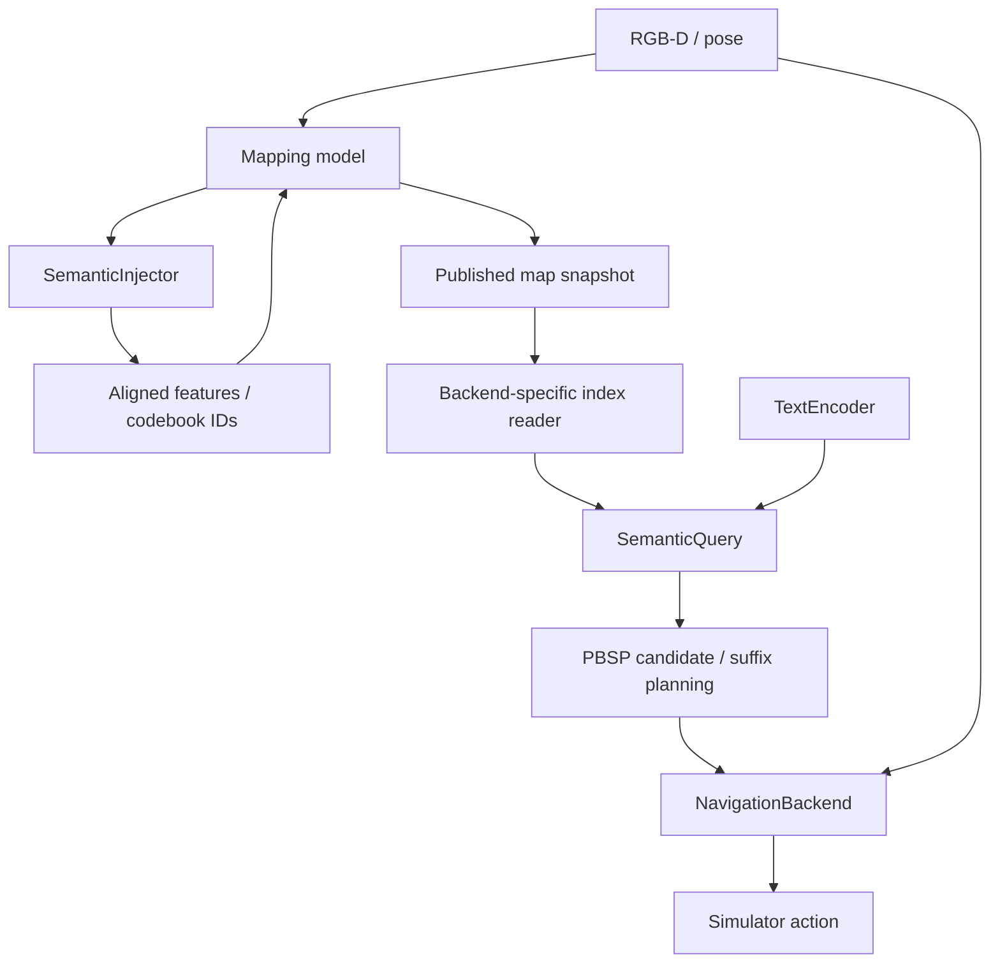

# Component interfaces

PBSP separates mapping, semantic injection, query and navigation at the points used by the running system. Candidate evidence, ordered-suffix planning and target verification remain PBSP policy.



The arrows describe data dependencies. Semantic injection runs during each accepted-view update; geometry and semantic coefficients are published together.

## Mapping

[OnlineMapper](../pbsp/mapping/mapper.py) owns keyframe admission, asynchronous updates, episode state and snapshot publication. [OnlineMappingModel](../pbsp/mapping/model.py) supplies context preparation and incremental reconstruction.

A replacement model supplies `build_context(frames, device=...)`, `update(context, scene_key=..., resume_state=...)` and `close()`. The current map store is EmbodiedSplat Gaussian state. Replacing that representation also requires its snapshot reader and artifact exporter.

The query implementation is supplied separately:

```python
mapper = OnlineMapper(
    settings=method.mapping,
    model=mapping_model,
    query_backend=queries,
    device="cuda",
)
```

`mapping_model`, `queries` and `method` are prepared objects supplied by the assembly layer. Mapping configuration controls keyframes and reconstruction resources. Retrieval thresholds and `top_k` live in `method.query`.

## Semantic injection

[SemanticInjector](../pbsp/semantics/types.py) consumes an image batch, optional per-image caches, image shape and semantic state. It returns a `SemanticInjection`:

| Field | Meaning |
| --- | --- |
| `dense_features` | B×D×H×W image features, or `None` for a codebook-only representation |
| `pixel_indices` | B×H×W stable codebook indices, or `None` for a dense-only representation |
| `state` | Updated codebook and semantic state shared with fusion |

The default [semantic feature implementation](../pbsp/semantics/features.py) preserves the original pooling and codebook operations. [Its adapter](../adapters/embodied_splat_semantics.py) supplies region/CLIP resources without giving it geometry layers. A weak resource reference preserves the existing model parameter names and resource cleanup.

Supply another injector when loading the model through `adapters.embodied_splat.load_model(..., semantic_injector=injector)`, or set `encoder.semantic_injector` before inference. Both warmup and incremental reconstruction call this interface. A replacement must keep pixel alignment, feature dimensions and existing codebook IDs consistent with the selected fusion representation.

Geometric reconstruction and semantic coefficient fusion still share the default Gaussian store. Replacing that storage format requires a corresponding mapping adapter; changing only the image embedding backend uses the injector interface.

## Query

[SemanticQuery](../pbsp/query/service.py) receives three independent objects: `QuerySettings`, a `TextEncoder` and a `read_index(snapshot)` callable. It does not import a mapping model or navigation policy.

The reader returns a [SemanticIndex](../pbsp/query/types.py) with CPU world positions, a normalized codebook, and three sparse coefficients per point. Positions use Habitat world xyz in metres, with y up. [The EmbodiedSplat reader](../adapters/embodied_splat_query.py) converts Gaussian storage and its coordinates to this contract.

`FeatureSpace(name, dimension)` identifies the embedding model/checkpoint. The index and text encoder must agree; mismatches fail before text inference. A replacement text encoder implements `encode(prompts, device=...)` and declares its feature space.

An entirely different retrieval method can implement `QueryBackend.query()` and `query_many()` directly. Preserve world coordinates and versioned candidate records: position, raw rank, semantic score, support count/score and map revision. The runtime provider attaches episode/task identity and query serial before suffix planning.

## Navigation

[NavigationBackend](../pbsp/navigation/backends.py) runs inside the real Navigator path. It receives:

- `NavigationFrame`: RGB, metric depth, world pose `[qw,qx,qy,qz,x,y,z]`, episode-local GPS and compass;
- `NavigationRequest`: selected world waypoint, task/step identity, map-version token and local planner inputs;
- lifecycle calls for episode reset, task reset and close.

The frame excludes evaluation labels and the ground-truth top-down map. `NavigationPlan` returns a simulator action, optional local-plan diagnostics and an error. PBSP keeps its verified-target and task-budget STOP rules.

[HabitatEnvironment](../adapters/habitat.py) translates sensor frames and task queries before they reach the Agent. It receives explicit observation settings, categories, segmentation construction and action IDs. Importing the adapter does not load Habitat or perception models. Detic and disabled modes do not read the semantic sensor or scene annotations.

[GoatEvaluator](../experiments/evaluator.py) reads success and path measurements after an action and before task reset. The experiment visualization observer reads its top-down map separately. Navigator updates its previous position from GPS even when evaluation visualization is absent. The legacy environment name remains an assembly boundary; the active experiment uses the evaluator directly.

`LocalPlannerBackend` adapts the current planner with unchanged arguments. To replace waypoint following while retaining exploration before a memory goal exists:

```python
agent.navigation_backend = WaypointNavigationBackend(
    controller=controller,
    exploration=LocalPlannerBackend(agent.planner),
)
```

The supplied controller implements `step(request) -> NavigationPlan`, `reset_episode()`, `reset_task()` and `close()`. It translates its native action to the current simulator's action enum. Sensor normalization, coordinate conversion and recurrent state belong to that adapter.

## VLFM and ApexNav integration

| Target | Useful boundary | Work required in its adapter |
| --- | --- | --- |
| [VLFM PointNav](https://github.com/rai-opensource/vlfm/blob/main/vlfm/policy/base_objectnav_policy.py) | Follow a PBSP-selected waypoint | Convert world waypoints to its `(rho, theta)` input; match depth preprocessing; reset recurrent state on task/goal changes; translate action tensors |
| [ApexNav ROS](https://github.com/Robotics-STAR-Lab/ApexNav/blob/main/habitat_evaluation.py) | Run an external navigation process | Connect sensor/pose and target messages, bind replies to the current episode/task/step, translate its action messages, and handle process/reset lifecycle |

These adapters are not bundled or evaluated yet. VLFM's full exploration policy also owns goal selection and mapping; adopting it is a broader policy replacement than using its PointNav controller. ApexNav's existing ROS evaluation interface needs an explicit way to consume PBSP-selected waypoints. Continuous control additionally requires an environment adapter that accepts velocity commands.

## Verify a replacement

Run the relevant interface tests, then a complete ordered smoke episode. Check task identities, candidate versions, reset behavior and realized actions. Use the same data and evaluation protocol when comparing navigation backends; report changed model weights and action spaces in the run provenance.
