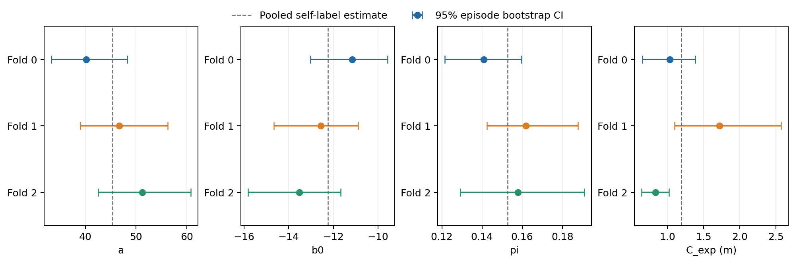
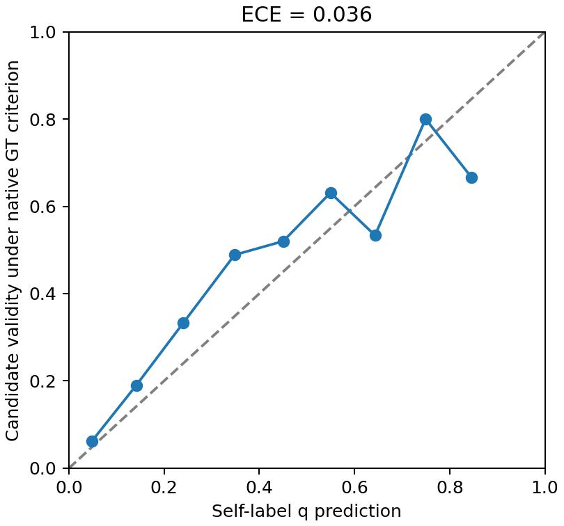
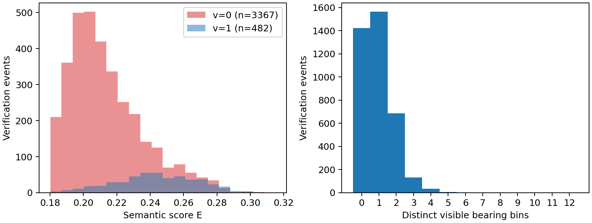

# CP2a：前三组标定审查

360条2-MON已完整结束。三组各200次episode自助重采样全部成功；各组相对合并参数的决策翻转率均低于0.7%。但C_exp的组间95%区间不重叠，按设计第2.5节，**不能直接冻结pooled参数，应改用交叉拟合并等待确认**。

建议使用下文已列出的三组交叉拟合参数继续。暂不补第4、5组：已有3849次检查，决策对参数变化的敏感性较低；新增组不会改变现有两组已不重叠的区间。若优先覆盖全部20个场景，可另补240条2-MON，再重新审查，但这不是恢复pooled资格的办法。

当前未生成冻结的calibration.json，未运行Full 3-MON。交叉拟合的运行时加载尚未实现；本文件及JSON均为可审阅提案。

数据按固定seed=20261107分组。运行源码为d94ca7d所绑定的同一指纹，收集期间未修改；12个原生launcher均正常退出。完整身份、source episode、目标顺序、轨迹和STOP核查通过。

| Fold | 场景 | Episode | 检查事件 | 被检查的不同候选 | 确认的不同候选 | 完成的探索事件 |
| --- | --- | --- | --- | --- | --- | --- |
| 0 | 6s7QHgap2fW, TEEsavR23oF, QaLdnwvtxbs, cvZr5TUy5C5 | 120 | 1446 | 1199 | 169 | 120 |
| 1 | Nfvxx8J5NCo, p53SfW6mjZe, 4ok3usBNeis, zt1RVoi7PcG | 120 | 1357 | 1106 | 179 | 120 |
| 2 | XB4GS9ShBRE, svBbv1Pavdk, wcojb4TFT35, DYehNKdT76V | 120 | 1046 | 849 | 134 | 121 |

逻辑回归使用每次最终验证事件的v；π按持久空间身份去重，统计是否曾被确认。两者分母不同。两项均只使用被检查的候选，存在选择偏差。E沿用用户确认的单个候选高斯codebook加权文本分数；B表示检查时被系统确认的概率。

自标定参数如下。a严格为正；C_exp单位为米。

| 参数集 | a | b0 | pi | c_exp |
| --- | --- | --- | --- | --- |
| Fold 0 | 40.216274 | -11.148140 | 0.140951 | 1.032108 |
| Fold 1 | 46.660085 | -12.564366 | 0.161844 | 1.719345 |
| Fold 2 | 51.239154 | -13.517022 | 0.157833 | 0.836204 |
| Pooled | 45.247047 | -12.236784 | 0.152822 | 1.194889 |

每组按episode完整重采样200次，随机种子为20261107+fold，95%区间为：

| Fold | a | b0 | pi | c_exp |
| --- | --- | --- | --- | --- |
| 0 | [33.276103, 48.274237] | [-13.018880, -9.564685] | [0.121445, 0.159681] | [0.656562, 1.383908] |
| 1 | [38.990305, 56.197994] | [-14.669679, -10.883830] | [0.142355, 0.187741] | [1.099441, 2.572049] |
| 2 | [42.549945, 60.804730] | [-15.824227, -11.672143] | [0.129276, 0.190998] | [0.643488, 1.024613] |

a、b0、π均有共同区间；C_exp没有。具体为Fold 1的[1.099441, 2.572049]与Fold 2的[0.643488, 1.024613]米不相交，间隔约0.0748米。即使翻转率很低，设计也同时要求区间重叠，不能放宽该规则。

| 参数 | 组均值 | 总体标准差 | 最小 | 最大 | 极差 |
| --- | --- | --- | --- | --- | --- |
| a | 46.038504 | 4.521485 | 40.216274 | 51.239154 | 11.022880 |
| b0 | -12.409843 | 0.973245 | -13.517022 | -11.148140 | 2.368882 |
| pi | 0.153543 | 0.009053 | 0.140951 | 0.161844 | 0.020894 |
| c_exp | 1.195886 | 0.378684 | 0.836204 | 1.719345 | 0.883141 |

下面以y代替v拟合的参数仅用于诊断，不进入提案或导航。

| GT诊断参数集 | a | b0 | pi | c_exp |
| --- | --- | --- | --- | --- |
| Fold 0 | 33.165262 | -9.470309 | 0.133445 | 1.032108 |
| Fold 1 | 49.772442 | -12.831356 | 0.201627 | 1.719345 |
| Fold 2 | 64.677348 | -16.068517 | 0.202591 | 0.836204 |
| Pooled GT | 46.404800 | -12.175014 | 0.175967 | 1.194889 |

混淆矩阵以系统确认v为预测、原生GOAT候选坐标判据y为真值。FPR=FP/(FP+TN)，FNR=FN/(FN+TP)；不是只看确认样本的错误比例。

| 数据 | TP | TN | FP | FN | 一致率 | FPR | FNR | ECE vs GT |
| --- | --- | --- | --- | --- | --- | --- | --- | --- |
| Fold 0 | 98 | 1202 | 71 | 75 | 89.90% | 5.58% | 43.35% | 0.018853 |
| Fold 1 | 129 | 1066 | 50 | 112 | 88.06% | 4.48% | 46.47% | 0.047847 |
| Fold 2 | 91 | 810 | 43 | 102 | 86.14% | 5.04% | 52.85% | 0.056405 |
| Pooled | 318 | 3078 | 164 | 289 | 88.23% | 5.06% | 47.61% | 0.035600 |

GT诊断显示系统确认会漏掉部分GT有效候选；不能将q或B直接解释为GT成功概率。可靠性图使用q=sigmoid(aE+b0)，分10档，以下为各档实际样本量。该图是标定数据内诊断，不是独立验证集表现。

| q档位 | n | 平均q | GT有效比例 |
| --- | --- | --- | --- |
| [0.0, 0.1) | 2474 | 0.047977 | 0.061439 |
| [0.1, 0.2) | 659 | 0.141336 | 0.189681 |
| [0.2, 0.3) | 270 | 0.240661 | 0.333333 |
| [0.3, 0.4) | 176 | 0.348032 | 0.488636 |
| [0.4, 0.5) | 125 | 0.450150 | 0.520000 |
| [0.5, 0.6) | 84 | 0.549493 | 0.630952 |
| [0.6, 0.7) | 45 | 0.643123 | 0.533333 |
| [0.7, 0.8) | 10 | 0.749312 | 0.800000 |
| [0.8, 0.9) | 6 | 0.845429 | 0.666667 |
| [0.9, 1.0] | 0 | — | — |

离线Full BLP重放使用全部19453个影子快照，分母包含3787个空根快照（None与None不翻转）；另列15666个非空根快照下的条件比例。以下比较不代表独立轨迹或3-MON成绩。

| 参数 vs Pooled | 翻转数 / 全快照 | 主翻转率 | 非空条件翻转率 |
| --- | --- | --- | --- |
| Fold 0 | 131/19453 | 0.67% | 0.84% |
| Fold 1 | 82/19453 | 0.42% | 0.52% |
| Fold 2 | 120/19453 | 0.62% | 0.77% |
| Pooled GT（仅诊断） | 289/19453 | 1.49% | 1.84% |

交叉拟合提案按待评估场景所属组排除整组数据。未收集的Fold 3、4按设计使用三组合并参数。以下四套参数全部来自v，没有GT参数。

| 评估场景所在组 | 拟合所用组 | a | b0 | pi | c_exp |
| --- | --- | --- | --- | --- | --- |
| Fold 0 | 1, 2 | 48.114599 | -12.856439 | 0.160102 | 1.275942 |
| Fold 1 | 0, 2 | 44.269787 | -12.012254 | 0.147949 | 0.933749 |
| Fold 2 | 0, 1 | 43.680261 | -11.910766 | 0.150976 | 1.375727 |
| Fold 3、4 | 0, 1, 2 | 45.247047 | -12.236784 | 0.152822 | 1.194889 |

| Fold | 对应场景 |
| --- | --- |
| 0 | 6s7QHgap2fW, TEEsavR23oF, QaLdnwvtxbs, cvZr5TUy5C5 |
| 1 | Nfvxx8J5NCo, p53SfW6mjZe, 4ok3usBNeis, zt1RVoi7PcG |
| 2 | XB4GS9ShBRE, svBbv1Pavdk, wcojb4TFT35, DYehNKdT76V |
| 3 | qyAac8rV8Zk, bxsVRursffK, mL8ThkuaVTM, Dd4bFSTQ8gi |
| 4 | 5cdEh9F2hJL, q3zU7Yy5E5s, mv2HUxq3B53, ziup5kvtCCR |

有两条激活事件没有对应的首候选完成记录：DYehNKdT76V/5/k0和wcojb4TFT35/17/k1。C_exp使用361条完成记录的条件均值，没有为未完成事件虚构0米；报告保留这项删失限制。

2-MON和3-MON是不同的有序episode文件，但共享12个场景、720个底层source episode；12条评估episode的前两目标顺序与标定一致。因此不能声称独立场景或目标泛化。此分析没有读取3-MON评估结果。

固定原生GOAT离线核查覆盖全部360条标定和两次排除拟合的隔离管线：3880条候选标签、7246条恢复点标签及测地距离全部匹配，最大距离误差0。标定保留13处旧式无效路径归属缺口，不影响E、S、v/y或C_exp；正式CP3前仍须采纳已在隔离工作区验证的逐动作记录补丁。

数值求解有2次v标签优化器状态失败，均使用同一正斜率MLE目标重试并通过约束KKT检查；600次bootstrap全部成功，无一类标签或分离失败被伪造为有限值。详见元数据中的numerical_optimizer_retry。

可复查材料：[完整拟合JSON](../meta/calibration_per_fold.json)、[交叉拟合提案（未冻结）](../meta/calibration.crossfit.proposed.json)、[数据与SHA清单](../meta/CP2a_data_summary.json)、[场景分组](../meta/folds.json)、[完整场景审计](../meta/completed-calibration-scene-audits.json)、[原生GT核查](../diagnostics/native-offline-gt-check.json)、[数据重叠审计](../meta/calibration-overlap-audit.json)。

三个组的完整事件与快照另以gzip随仓库保存，[压缩清单](../meta/calibration-log-archive.json)列出6份文件的原始及压缩SHA256，解压后逐字节一致。原始未压缩日志仍保留在服务器results/exp4/logs/；可用于复现拟合和19453快照重放。

下一步待确认：采用上述三组交叉拟合参数，完成加载实现、记录补丁及源码绑定后冻结，并进入固定20条Full冒烟；或先补齐第4、5组再重审。当前没有把提案作为可用的冻结参数。
