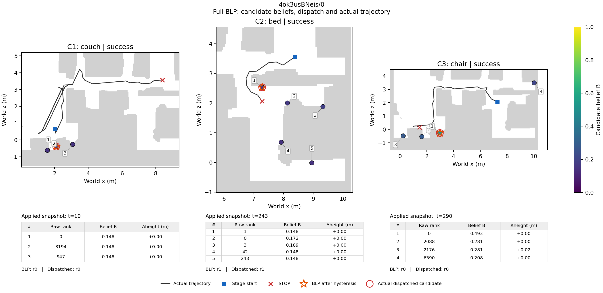
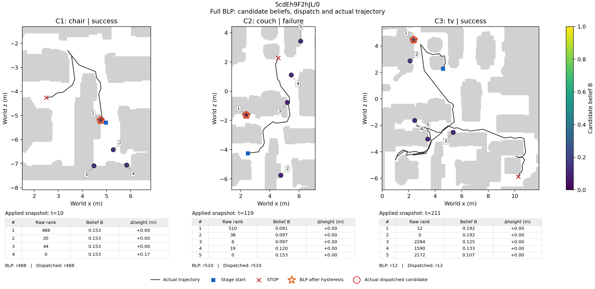

# CP3过程记录：Full固定冒烟进行中

记录时间：2026-11-09T03:53:28.909424+00:00。固定20条目前完成6/20，已按正式口径核查6条。最终CP3尚未完成，Full400未启动。下表列已完成且已核查的回合，不代表最终20条汇总。

已核查回合均通过身份、冻结参数、原生指标及逐动作路径检查，无路径归属缺口。参数未调整，GT只用于事后诊断。

| 场景/episode | 三阶段成功 | 步数 | SR (%) | SPL (%) | PR (%) | PPL (%) | 无效访问数 | 规划中位/P95 (ms) | 实际偏离最近 (%) |
| --- | --- | --- | --- | --- | --- | --- | --- | --- | --- |
| 4ok3usBNeis/0 | 1/1/1 | 467 | 100.00 | 34.72 | 100.00 | 34.72 | 8 | 16.89/21.06 | 27.27 |
| 5cdEh9F2hJL/0 | 1/0/1 | 568 | 0.00 | 0.00 | 66.67 | 39.69 | 15 | 8.93/22.58 | 18.37 |
| 6s7QHgap2fW/0 | 0/0/1 | 1064 | 0.00 | 0.00 | 33.33 | 0.00 | 23 | 10.74/17.23 | 22.34 |
| DYehNKdT76V/0 | 1/0/0 | 1052 | 0.00 | 0.00 | 33.33 | 28.95 | 8 | 4.24/16.31 | 15.38 |
| Dd4bFSTQ8gi/0 | 0/0/1 | 670 | 0.00 | 0.00 | 33.33 | 0.00 | 17 | 11.87/16.49 | 29.79 |
| Nfvxx8J5NCo/0 | 0/1/1 | 659 | 0.00 | 0.00 | 66.67 | 0.00 | 7 | 13.82/15.93 | 58.06 |

已审查的18个阶段中，原生成功10个、预算耗尽后失败6个、系统确认后原生失败2个。这些是观察到的STOP/结局分类，不是因果归因。

4ok的首阶段路径为38.75米，原生最短路径为8.01米，仍有较多候选检查和绕行。5cd的couch阶段以系统确认结束，但原生成功为0，最后一次候选检查为v=1、y=0。候选坐标GT与最终agent成功分别保留：5cd的TV最后检查y=0，但agent随后移动并最终成功。

已完成回合共463个快照的Full记录重放一致，101个末阶段非空快照满足Full/Myopic及Suffix-only/Nearest的Q等价关系。374个非空根中，Full与Nearest的无约束提议不同66次，Full与Myopic不同12次。这只是相同Full输入上的反事实诊断，不是其他变体的在线运行或成绩。

四套冻结参数已在首四条真实运行中覆盖：Fold0、Fold1、Fold2分别排除自身组，未收集组使用pool。完整20场景映射仍随剩余回合继续核查。

例图固定采用清单最先运行的两条，不按结果挑例。每阶段显示最早已实际下发且至少有两个候选的快照，否则使用最早非空已下发快照；黑线为完整阶段实际轨迹。编号对应belief表，橙星为滞回后BLP选择，红圈为实际下发。布局调整前后的候选、数值和快照选择完全一致。

继续监督剩余固定回合。20条全部完成后，report_cp3.py才允许生成总体CP3报告；该工具不写接受记录、不启动worker。Full400仍须在具体CP3审查后推进。
