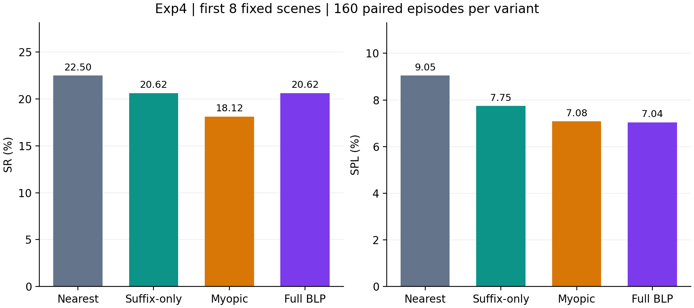
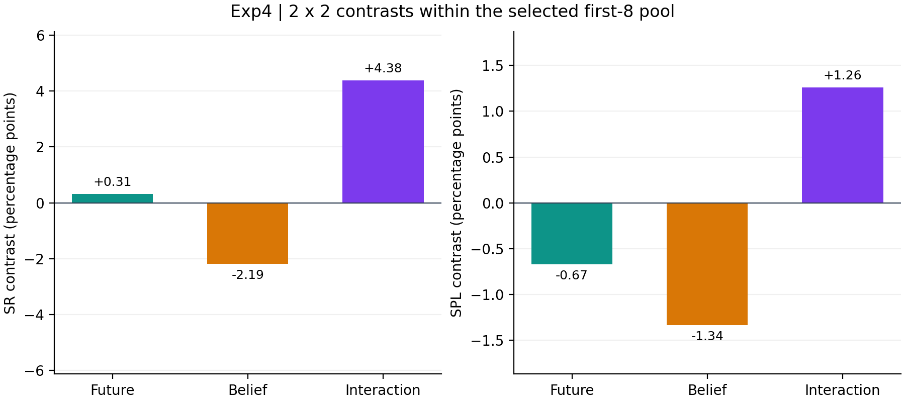

# Exp4 CP5：固定前8场景的2×2消融

四个变体各完成同样160条3-MON任务，覆盖原固定清单前8个场景、每场景20条，共640条。所有场景都保留成功和失败回合；每组480段实际动作路径已经核对。

用户在已获得部分结果后将范围从20场景缩至固定前8场景。场景沿用原清单顺序，没有根据本次成绩重排。原任务池本身经过历史1-MON结果筛选，因此本报告描述该固定池内的消融，不作为独立盲测或未见任务泛化证据。原Full400及范围外原始记录保留。

算法、三组交叉拟合参数和共享导航机制沿用已确认版本。实验后半段按用户授权扩至8张GPU，健康原生进程在CPU交接时继续运行，完成状态保留真实OS退出证据。不同阶段的共享资源条件有变化，规划耗时不能作为已隔离资源影响的独立因果比较。

E沿用当前代码的候选高斯加权文本分数，并非邻近支撑集上的平均目标相关度；这是用户已确认保留的实现口径。belief参数只使用系统两阶段验证标签拟合，真值标签用于诊断，评估期间参数冻结。详见[E定义与论文表述说明](../reports/eq5_wording.md)及[标定报告](../reports/CP2a.md)。

Myopic的DY与6s场景各有一次因显存不足而废弃的原生尝试，分别导出13条、16条。两次尝试的29条记录整体保留并全部排除；两个场景各按同样固定20条身份、seed及冻结算法参数完整重跑后进入本表，其余健康场景保留。没有按导航成败选择重跑回合。故障发生在共享资源占用变化期间；候选地图已经失效时，仍更新的导航轨迹不能证明运行健康。

第二次故障经日志确认后，由操作器对该本账号场景启动器发送SIGTERM并调用原生清理流程，原启动器实际退出143；该状态不记为成功退出。当前表格中所有正式场景均已完整结束并记录真实退出0。两个故障原始档案额外保留，不计入下述32个正式场景档案。

[故障恢复计划](../scopes/first8/meta/infrastructure-recovery-v2-20261113.json)、[执行偏差与资源保护](../scopes/first8/deviations.md)。

| Variant | Future | Belief | SR (%) | SPL (%) | PR (%) | PPL (%) | P(C1) (%) | P(C2∣C1) (%) | P(C3∣C1,C2) (%) | Invalid visits/ep | Proposal deviation (%) |
| --- | --- | --- | --- | --- | --- | --- | --- | --- | --- | --- | --- |
| Nearest | ✗ | ✗ | 22.50 | 9.05 | 56.46 | 15.15 | 50.62 | 66.67 | 66.67 | 11.49 | 0.00 |
| Suffix-only | ✓ | ✗ | 20.62 | 7.75 | 55.62 | 14.94 | 50.00 | 63.75 | 64.71 | 12.00 | 11.68 |
| Belief-myopic | ✗ | ✓ | 18.12 | 7.08 | 56.67 | 14.75 | 52.50 | 51.19 | 67.44 | 11.74 | 15.36 |
| Full BLP | ✓ | ✓ | 20.62 | 7.04 | 56.25 | 15.18 | 52.50 | 59.52 | 66.00 | 11.48 | 13.46 |

SR、SPL、PR来自原生评估器；PPL为补充指标，按全部阶段PR与成功前缀路径效率计算。比率展示保留两位，主效应及交互项使用未舍入值。条件成功率只在前序全部成功的回合中计算。

| Metric | Future effect (pp) | Belief effect (pp) | Interaction (pp) |
| --- | --- | --- | --- |
| SR | 0.31 | -2.19 | 4.38 |
| SPL | -0.67 | -1.34 | 1.26 |

前瞻主效应=[(Suffix−Nearest)+(Full−Myopic)]/2；belief主效应=[(Myopic−Nearest)+(Full−Suffix)]/2；交互项=(Full−Myopic)−(Suffix−Nearest)。

| Pair | Both success | Left only | Right only | Both failure | Paired N |
| --- | --- | --- | --- | --- | --- |
| nearest_vs_suffix_only | 21 | 15 | 12 | 112 | 160 |
| nearest_vs_myopic | 19 | 17 | 10 | 114 | 160 |
| nearest_vs_full | 18 | 18 | 15 | 109 | 160 |
| suffix_only_vs_myopic | 16 | 17 | 13 | 114 | 160 |
| suffix_only_vs_full | 20 | 13 | 13 | 114 | 160 |
| myopic_vs_full | 17 | 12 | 16 | 115 | 160 |

六组逐回合配对CSV各160条，成功不一致计数与上表、原始分数均已回读核对。

| Variant | Invalid path/ep (m) | Identity path upper/ep (m) | After hysteresis deviation (%) | Applied deviation (%) | Planning median (ms) | Planning P95 (ms) |
| --- | --- | --- | --- | --- | --- | --- |
| Nearest | 19.16 | 19.20 | 7.05 | 13.49 | 5.07 | 10.96 |
| Suffix-only | 22.32 | 22.33 | 14.80 | 20.17 | 10.54 | 25.73 |
| Belief-myopic | 20.46 | 20.47 | 18.74 | 24.33 | 5.80 | 12.15 |
| Full BLP | 19.75 | 19.76 | 16.66 | 21.58 | 10.27 | 27.24 |

Nearest的无约束proposal偏离率已核对为0。四组共享的1米切换滞回、类别冷却等机制仍可改变最终实际下发，三个偏离口径分别保留。无效访问路径按接受动作与检查时坐标GT关联；身份追逐路径单列为上界。

| Variant | Boundary | Root decisions | Decision incidence | Memo-state hits |
| --- | --- | --- | --- | --- |
| Nearest | empty_candidates | 1878 | 0 | 0 |
| Nearest | frontier_coordinates_unavailable | 0 | 0 | 0 |
| Nearest | no_reachable_frontier | 0 | 0 | 0 |
| Suffix-only | empty_candidates | 1998 | 45 | 165 |
| Suffix-only | frontier_coordinates_unavailable | 0 | 0 | 0 |
| Suffix-only | no_reachable_frontier | 0 | 0 | 0 |
| Belief-myopic | empty_candidates | 2002 | 8716 | 31824 |
| Belief-myopic | frontier_coordinates_unavailable | 0 | 0 | 0 |
| Belief-myopic | no_reachable_frontier | 0 | 1077 | 4031 |
| Full BLP | empty_candidates | 2180 | 8557 | 74329 |
| Full BLP | frontier_coordinates_unavailable | 0 | 0 | 0 |
| Full BLP | no_reachable_frontier | 0 | 1212 | 8158 |

32个场景级原始配置/日志归档包含launch、真实完成状态、源码快照、三目标身份、原生指标、轨迹、BLP/SCSP记录和mapping/navigation环境。归档创建时逐文件回读SHA核对，最终索引与档案外层SHA再次核对。图片和模型/地图二进制不在这份原始日志归档内；原始目录继续保留。

[固定身份与范围](../scopes/first8/meta/scope.json)、[冻结参数](../meta/calibration.json)、[数据适用范围](../reports/dataset_scope.md)、[六组配对CSV](../scopes/first8/summary/paired/manifest.json)、[原始归档清单](../scopes/first8/meta/raw-archives/manifest.json)。
[CP1](../reports/CP1.md)、[CP2a](../reports/CP2a.md)、[CP3](../reports/CP3.md)、[原Full400 CP4](../reports/CP4.md)、[范围内四组汇总](../scopes/first8/summary/all.csv)。
