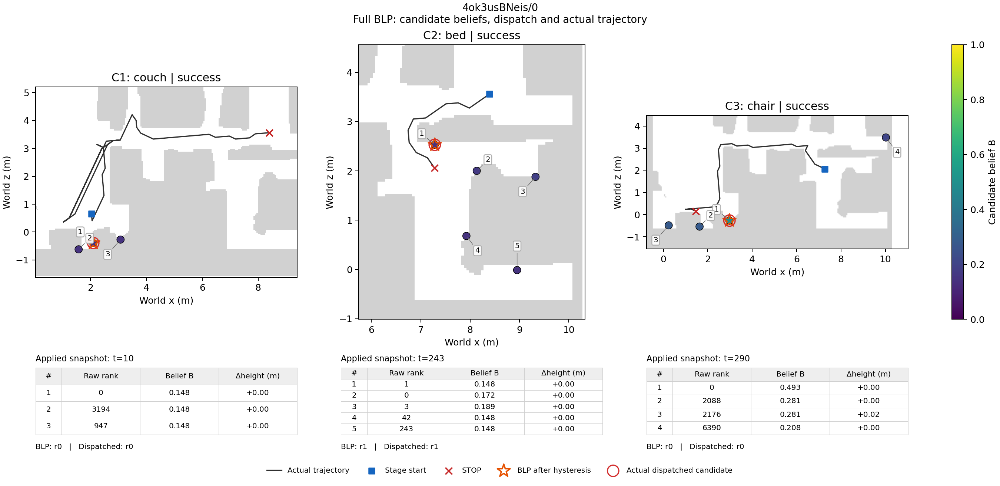
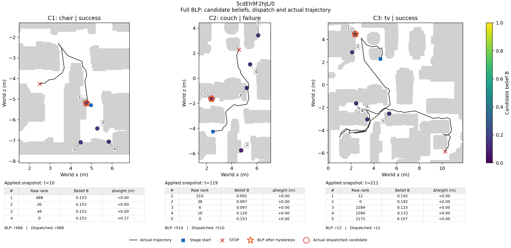

# a3固定Full冒烟：首两条复核

本表只覆盖清单最先运行的两个固定回合。其余回合继续运行，全部20条完成后才生成CP3报告。

| 场景/episode | 三阶段成功 | 步数 | 路径归属完整 | 与原生阶段路径最大误差(m) |
| --- | --- | --- | --- | --- |
| 4ok3usBNeis/0 | 1/1/1 | 387 | True | 5.22112995e-07 |
| 5cdEh9F2hJL/0 | 1/0/1 | 568 | True | 2.32223712e-07 |

两例均通过冻结身份/目标顺序及完整路径核查，6个阶段路径数值最大误差小于5.3e-7m。已完成的99个快照重放无Q/排序违例；320条当前候选q/S/B记录符合公式。末阶段Full/Myopic及Suffix-only/Nearest的Q等价核对通过。其他变体在这些Full输入上的提议属于反事实诊断，完整在线消融将在主评测中进行。

这两例的Python、环境锁和包清单在各自worker角色内一致；两个角色分别使用其实际记录的Python/torch版本，seed均为1。环境及覆盖审计文件当前只记录两个完成回合，全部20条结束后刷新。

图中候选与B值取自表格标出的实际派发快照；黑线为该阶段完整轨迹，包含后续重规划。例图按固定执行顺序确定，没有根据成功结果选择。两张PNG及数值元数据已逐份核SHA并实际查看。

[逐阶段结局](../diagnostics/CP3/completed-behavior-review.json)、[图像检查](../diagnostics/CP3/figure-review.json)、[机制重放](../diagnostics/CP3/mechanism-audit.json)、[覆盖公式核查](../diagnostics/CP3/evidence-coverage-audit.json)、[实际环境](../meta/environment-smoke.json)。
