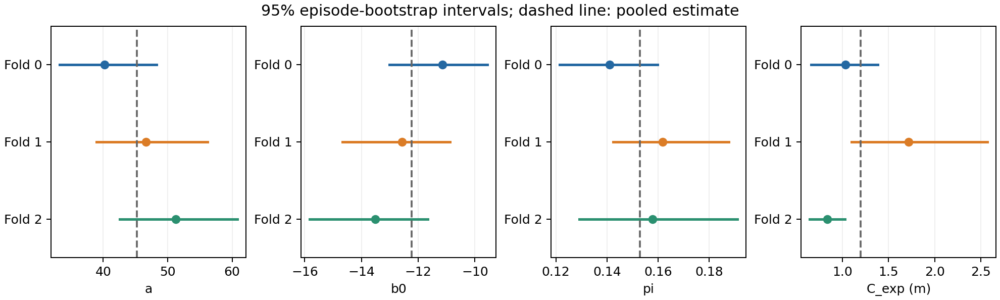
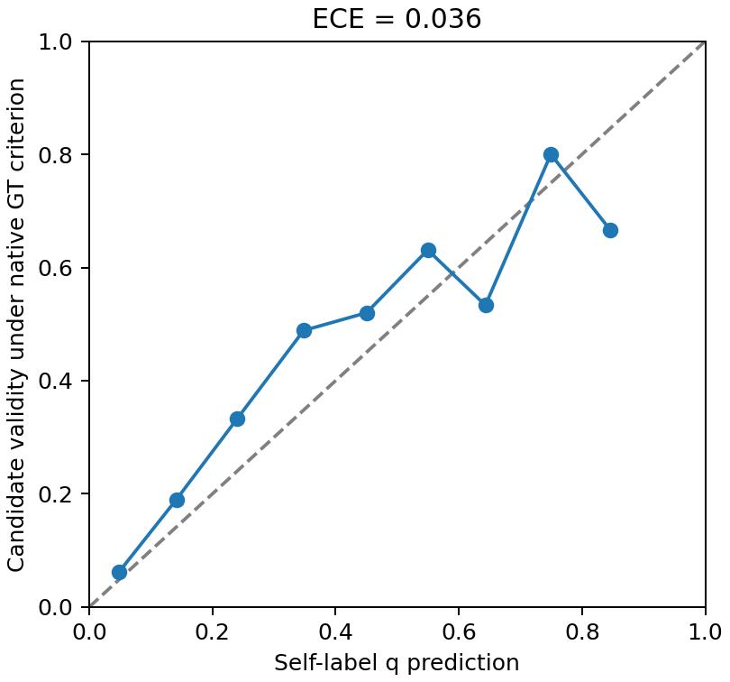
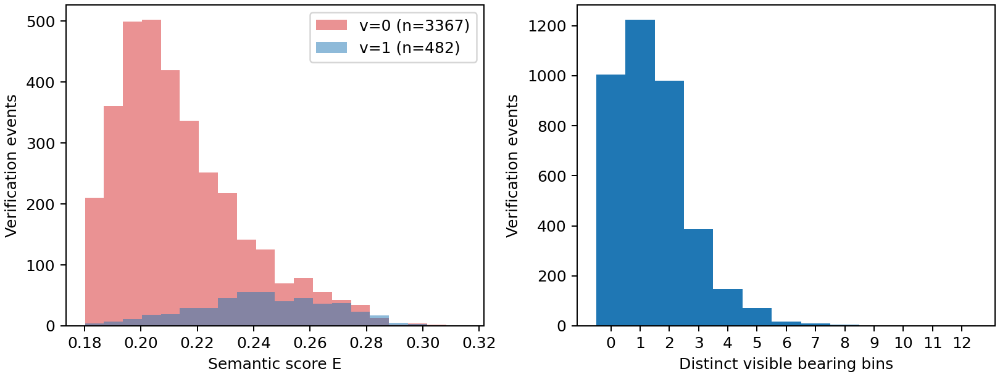

# CP2a：修正深度单位后的前三组标定

> 历史阶段报告：正文保留原阶段范围与结果；文内证据链接固定到原始提交391d7e2，不指向当前120条派生数据。

固定12场景、360条2-MON已完成。实际检查事件3849次，完成的空候选探索事件361次。三组各200次episode自助重采样成功。组间稳定性未同时满足翻转率不超过10%和参数区间重叠两个条件，按设计采用交叉拟合提案。

运行提交：`eaa29e5f8f46782554d31226a8d619ec2534c34a`。本报告仅使用a3收集、审计及绑定的拟合结果。当前参数尚未冻结，新的Full冒烟和四变体全量评估尚未开始。

| Fold | 场景 | Episode | 检查事件 | 不同候选 | 确认候选 | 完成探索 |
| --- | --- | --- | --- | --- | --- | --- |
| 0 | 6s7QHgap2fW, TEEsavR23oF, QaLdnwvtxbs, cvZr5TUy5C5 | 120 | 1446 | 1198 | 169 | 120 |
| 1 | Nfvxx8J5NCo, p53SfW6mjZe, 4ok3usBNeis, zt1RVoi7PcG | 120 | 1357 | 1106 | 179 | 120 |
| 2 | XB4GS9ShBRE, svBbv1Pavdk, wcojb4TFT35, DYehNKdT76V | 120 | 1046 | 849 | 134 | 121 |

逻辑回归保留每次最终检查事件拟合v；π按持久登记身份去重，同一scene/episode/task内最终检查坐标完全相同的不同ID再作合并，统计是否曾被系统确认。坐标合并不用距离阈值、v或GT，原始日志保留。两者分母不同，且只观察被检查的候选，存在选择偏差。E为用户确认保留的单个候选高斯codebook加权文本分数。S采用候选级12档方位覆盖，归一化深度在覆盖观察器中转换为米。B表示检查时被系统确认的概率。

| 自标签参数集 | a | b0 | pi | c_exp |
| --- | --- | --- | --- | --- |
| Fold 0 | 40.216274062 | -11.148140177 | 0.141068447 | 1.032107950 |
| Fold 1 | 46.660085251 | -12.564365707 | 0.161844485 | 1.719345172 |
| Fold 2 | 51.239153630 | -13.517022258 | 0.157832744 | 0.836203835 |
| Pooled | 45.247046846 | -12.236784283 | 0.152870282 | 1.194889304 |

C_exp单位为米。每组按完整episode重采样200次，种子为20261107+fold；95%区间如下。

| Fold | a | b0 | pi | c_exp |
| --- | --- | --- | --- | --- |
| 0 | [33.276103363, 48.274237223] | [-13.018879665, -9.564684942] | [0.121543189, 0.159779182] | [0.656562238, 1.383907898] |
| 1 | [38.990305183, 56.197993746] | [-14.669679204, -10.883830109] | [0.142355383, 0.187741040] | [1.099440815, 2.572049334] |
| 2 | [42.549944636, 60.804729545] | [-15.824227130, -11.672143206] | [0.129276293, 0.190997684] | [0.643487965, 1.024613023] |

| 参数 | 组间共同交集 | 均值 | 总体标准差 | 最小 | 最大 | 极差 |
| --- | --- | --- | --- | --- | --- | --- |
| a | True | 46.038504314 | 4.521485054 | 40.216274062 | 51.239153630 | 11.022879568 |
| b0 | True | -12.409842714 | 0.973244949 | -13.517022258 | -11.148140177 | 2.368882081 |
| pi | True | 0.153581892 | 0.008998638 | 0.141068447 | 0.161844485 | 0.020776037 |
| c_exp | False | 1.195885652 | 0.378683692 | 0.836203835 | 1.719345172 | 0.883141337 |

以下y拟合只用于偏差诊断，不进入提案或导航。

| GT诊断参数集 | a | b0 | pi | c_exp |
| --- | --- | --- | --- | --- |
| Fold 0 | 33.165262292 | -9.470309235 | 0.133555927 | 1.032107950 |
| Fold 1 | 49.772442374 | -12.831355779 | 0.201627486 | 1.719345172 |
| Fold 2 | 64.677348037 | -16.068517199 | 0.202591284 | 0.836203835 |
| Pooled GT | 46.404799648 | -12.175013525 | 0.176022835 | 1.194889304 |

混淆矩阵以系统确认v为预测、原生GOAT候选坐标判据y为真值。FPR=FP/(FP+TN)，FNR=FN/(FN+TP)。可靠性按q分10档，是标定数据内诊断。

| 数据 | TP | TN | FP | FN | 一致率 | FPR | FNR | ECE vs GT |
| --- | --- | --- | --- | --- | --- | --- | --- | --- |
| Fold 0 | 98 | 1202 | 71 | 75 | 89.9032% | 5.5774% | 43.3526% | 0.018852626 |
| Fold 1 | 129 | 1066 | 50 | 112 | 88.0619% | 4.4803% | 46.4730% | 0.047846874 |
| Fold 2 | 91 | 810 | 43 | 102 | 86.1377% | 5.0410% | 52.8497% | 0.056405354 |
| Pooled | 318 | 3078 | 164 | 289 | 88.2307% | 5.0586% | 47.6112% | 0.035600466 |

| q区间 | n | 平均q | GT有效比例 |
| --- | --- | --- | --- |
| 0.0至0.1 | 2474 | 0.047976831 | 0.061438965 |
| 0.1至0.2 | 659 | 0.141336481 | 0.189681335 |
| 0.2至0.3 | 270 | 0.240660740 | 0.333333333 |
| 0.3至0.4 | 176 | 0.348032449 | 0.488636364 |
| 0.4至0.5 | 125 | 0.450150441 | 0.520000000 |
| 0.5至0.6 | 84 | 0.549493364 | 0.630952381 |
| 0.6至0.7 | 45 | 0.643122808 | 0.533333333 |
| 0.7至0.8 | 10 | 0.749312349 | 0.800000000 |
| 0.8至0.9 | 6 | 0.845428566 | 0.666666667 |
| 0.9至1.0 | 0 | 未定义 | 未定义 |

决策敏感性重放使用全部影子快照；主分母包含空根快照，两边均不选候选时不算翻转。另报非空根条件比例。它不代表其他变体的独立轨迹或3-MON成绩。

| 参数 vs Pooled | 翻转数 | 全部快照 | 非空根 | 主翻转率 | 非空条件翻转率 |
| --- | --- | --- | --- | --- | --- |
| Fold 0 | 202 | 19453 | 15666 | 1.0384% | 1.2894% |
| Fold 1 | 79 | 19453 | 15666 | 0.4061% | 0.5043% |
| Fold 2 | 148 | 19453 | 15666 | 0.7608% | 0.9447% |
| Pooled GT（仅诊断） | 345 | 19453 | 15666 | 1.7735% | 2.2022% |

评估已收集组的场景时排除该组，Fold3、4使用三组合并参数。四套数值均来自v。

| 评估组 | 拟合组 | a | b0 | pi | c_exp |
| --- | --- | --- | --- | --- | --- |
| Fold 0 | 1, 2 | 48.114599083 | -12.856439210 | 0.160102302 | 1.275942260 |
| Fold 1 | 0, 2 | 44.269786779 | -12.012253606 | 0.148021495 | 0.933749452 |
| Fold 2 | 0, 1 | 43.680260713 | -11.910765740 | 0.151041667 | 1.375726561 |
| Fold 3、4 | 0, 1, 2 | 45.247046846 | -12.236784283 | 0.152870282 | 1.194889304 |

| Fold | 场景 |
| --- | --- |
| 0 | 6s7QHgap2fW, TEEsavR23oF, QaLdnwvtxbs, cvZr5TUy5C5 |
| 1 | Nfvxx8J5NCo, p53SfW6mjZe, 4ok3usBNeis, zt1RVoi7PcG |
| 2 | XB4GS9ShBRE, svBbv1Pavdk, wcojb4TFT35, DYehNKdT76V |
| 3 | qyAac8rV8Zk, bxsVRursffK, mL8ThkuaVTM, Dd4bFSTQ8gi |
| 4 | 5cdEh9F2hJL, q3zU7Yy5E5s, mv2HUxq3B53, ziup5kvtCCR |

尚有2条空候选激活事件没有首候选完成记录。C_exp仅用361条完成事件的条件均值，未完成事件没有填成0米。

| 场景 | episode | k（从0开始） |
| --- | --- | --- |
| DYehNKdT76V | 5 | 0 |
| wcojb4TFT35 | 17 | 1 |

标定与评估共享12个场景、720个底层source episode；12条评估episode前两目标顺序与标定一致。因此这些数据不支持独立场景或目标泛化的结论。

原生GT离线复核明确覆盖本次全部12个run，候选检查3849条，恢复点检查7220条。当前标定路径归属缺口总数为28。具体口径及原始证据保留在审计JSON中。

数值求解的重试次数及触发原因见calibration_per_fold.json的numerical_optimizer_retry；重试使用相同正斜率MLE目标并检查约束KKT残差。

本次参数或选择规则与此前已批准方案不同，需要审阅本报告的具体提案后确认。

本脚本只生成报告与未冻结提案。第4、5组未收集，后续仍按用户已选择的三组方案推进。下一步完成CP2审查与绑定，再运行新的固定20条Full冒烟。

[拟合结果](https://github.com/pieceHk/ForesightNav/blob/391d7e25b12171144a77cfbc41f220efe11294fb/results/exp4/meta/calibration_per_fold.json)、[拟合输入绑定](https://github.com/pieceHk/ForesightNav/blob/391d7e25b12171144a77cfbc41f220efe11294fb/results/exp4/meta/calibration-fit-binding.json)、[数据与SHA清单](https://github.com/pieceHk/ForesightNav/blob/391d7e25b12171144a77cfbc41f220efe11294fb/results/exp4/meta/CP2a_data_summary.json)、[场景分组](https://github.com/pieceHk/ForesightNav/blob/391d7e25b12171144a77cfbc41f220efe11294fb/results/exp4/meta/folds.json)、[场景审计](https://github.com/pieceHk/ForesightNav/blob/391d7e25b12171144a77cfbc41f220efe11294fb/results/exp4/meta/completed-calibration-scene-audits.json)、[原生GT复核](https://github.com/pieceHk/ForesightNav/blob/391d7e25b12171144a77cfbc41f220efe11294fb/results/exp4/diagnostics/native-offline-gt-check.json)、[压缩日志清单](https://github.com/pieceHk/ForesightNav/blob/391d7e25b12171144a77cfbc41f220efe11294fb/results/exp4/meta/calibration-log-archive.json)。
