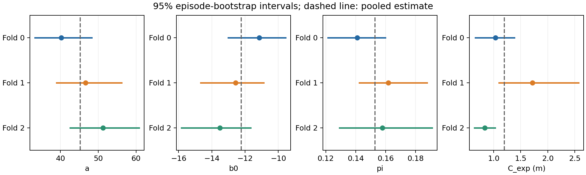
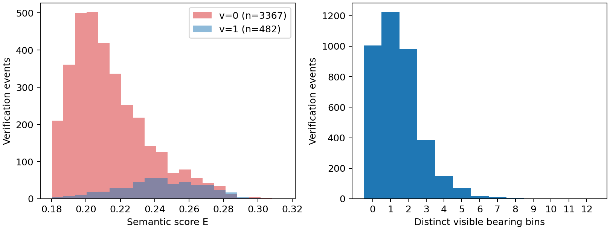
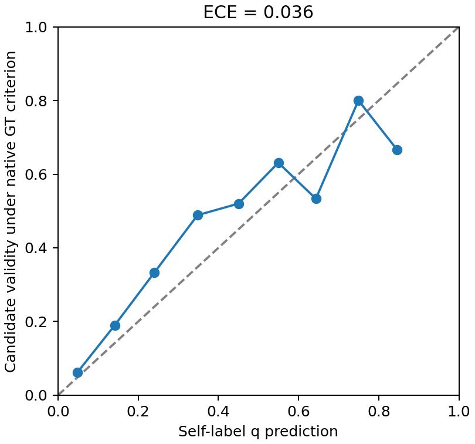

# CP2a/CP2b下一步具体提案（未接受）

> 历史阶段报告：正文保留原阶段范围与结果；文内证据链接固定到原始提交391d7e2，不指向当前120条派生数据。

360条标定、12场景完整审计和600次bootstrap已完成。建议沿用用户已选的三组交叉拟合方案：评估已收集组时排除本组，未收集的Fold3、4使用三组合并参数。三组决策翻转率0.4061%–1.0384%，但C_exp的95%区间无共同交集，按设计第2.5节不能改为pooled。

| 评估组 | 拟合组 | a | b0 | pi | C_exp (m) |
| --- | --- | --- | --- | --- | --- |
| 0 | 1, 2 | 48.114599083 | -12.856439210 | 0.160102302 | 1.275942260 |
| 1 | 0, 2 | 44.269786779 | -12.012253606 | 0.148021495 | 0.933749452 |
| 2 | 0, 1 | 43.680260713 | -11.910765740 | 0.151041667 | 1.375726561 |
| 3、4 | 0, 1, 2 | 45.247046846 | -12.236784283 | 0.152870282 | 1.194889304 |

本次四套数值与旧批准方案不同。具体未冻结文件为[calibration.crossfit.proposed.json](https://github.com/pieceHk/ForesightNav/blob/391d7e25b12171144a77cfbc41f220efe11294fb/results/exp4/meta/calibration.crossfit.proposed.json)，其SHA及原始日志/拟合版本绑定见[CP2a数据清单](https://github.com/pieceHk/ForesightNav/blob/391d7e25b12171144a77cfbc41f220efe11294fb/results/exp4/meta/CP2a_data_summary.json)。当前不存在新的calibration.json或接受记录。

[完整CP2a报告](https://github.com/pieceHk/ForesightNav/blob/391d7e25b12171144a77cfbc41f220efe11294fb/results/exp4/reports/CP2a.md)包含全部区间、θ_f/GT对照、混淆矩阵、可靠性、决策翻转及固定场景组。E保留单个候选高斯的codebook加权文本分数，π按已检查的精确坐标身份统计，所有verification_final事件均保留。GT只作偏差诊断。2条未完成空候选激活不填0；C_exp使用361条完成事件的条件均值。

原始28帧归属缺口完整保留，最后两场景没有新增。已验证的被动logger修正03242fd尚未采纳；待本次参数确认后，才在实际评估源码中采纳，实际执行60项检查及219次关闭模式匹配输入回放并生成CP2b绑定。先前隔离验证不能替代这次实际执行。

确认本提案后：冻结本次数值及其证据，完成上述源码验证与CP2b绑定，再在GPU2、3运行固定20条Full冒烟，检查全套导航/过程指标和两张指定俯视图。全量Full400仍需新的CP3报告确认。当前未运行新的Full冒烟或四组1600条主评测，不能据这些标定翻转率宣称SR/SPL提升。

设计第2.5节原文：“此时停下汇报，等待确认。”本次请求确认的是更新后的具体数值；三组继续、E口径及共享滞回/冷却等既有选择不重问。
