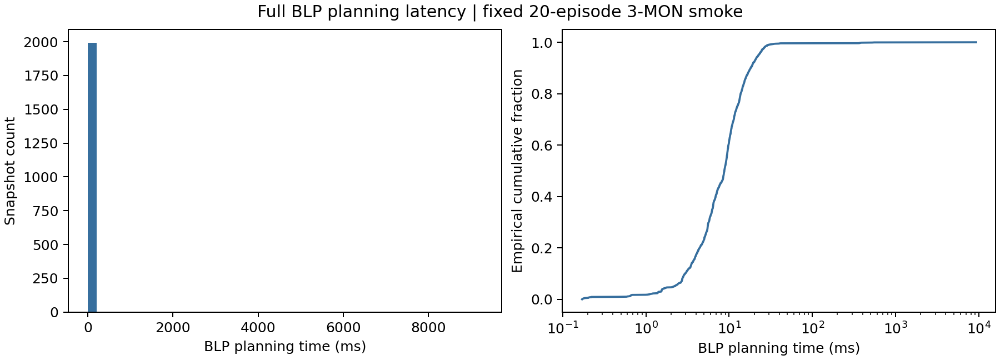
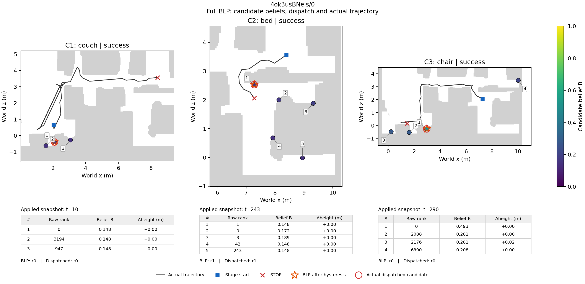
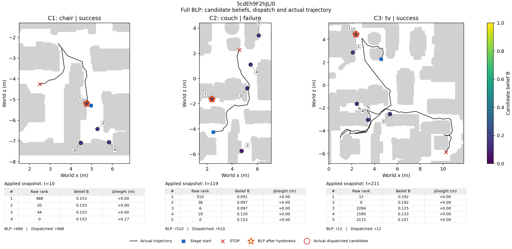

# Exp4 CP3：固定20条Full冒烟

> 历史阶段报告：正文保留原阶段范围与结果；文内证据链接固定到原始提交391d7e2，不指向当前120条派生数据。

## 完成了什么

固定20个场景各1条3-MON全部完成。场景、source episode和目标顺序与冻结清单一致，参数采用cross_fit，按冻结分配加载；未使用GT调参。四变体全量评估尚未启动。

运行提交：`03242fda76fd6a631596a7269c8e7990c657ea30`。源码指纹、参数SHA、原生完成状态、60阶段路径及全部规范化日志已核对。

固定任务池来自历史1-MON配对结果筛选，属于受控内部消融，不能据此声称独立盲测或跨数据泛化。它与本次四变体的在线成绩不同；本次3-MON结果未用于拟合、选参数或删选回合。[数据来源、原始manifest/trace及静态高度与navmesh诊断](https://github.com/pieceHk/ForesightNav/blob/391d7e25b12171144a77cfbc41f220efe11294fb/results/exp4/reports/dataset_scope.md)列明适用范围；高度相近不等于同楼层或策略可达。

[本阶段环境与GPU配置](https://github.com/pieceHk/ForesightNav/blob/391d7e25b12171144a77cfbc41f220efe11294fb/results/exp4/meta/environment-smoke.json)覆盖全部20条，角色Python、锁文件及包清单一致；每条原生run还保留独立环境文件。[观测覆盖检查](https://github.com/pieceHk/ForesightNav/blob/391d7e25b12171144a77cfbc41f220efe11294fb/results/exp4/diagnostics/CP3/evidence-coverage-audit.json)分别统计当前与未来目标的有效视角，不使用GT。

## 关键数字

| 指标 | 结果 |
| --- | --- |
| SR (%) | 15.00 |
| SPL (%) | 6.67 |
| PR (%) | 35.00 |
| PPL (%) | 10.88 |
| P_C1 (%) | 35.00 |
| P_C2_given_C1 (%) | 57.14 |
| P_C3_given_C1C2 (%) | 75.00 |
| Joint (%) | 15.00 |

PPL为新增补充实现：全部阶段PR乘以成功前缀的路径效率。原生PBSP在阶段失败后继续执行后续阶段；条件率只在前序全成功的子集计算，分母为0时留为未定义。

| 阶段 | 前序全成功episode数 | 本阶段成功数 | 条件率 (%) |
| --- | --- | --- | --- |
| C1 | 20 | 7 | 35.00 |
| C2 | 7 | 4 | 57.14 |
| C3 | 4 | 3 | 75.00 |

| 过程指标 | 结果 |
| --- | --- |
| GT无效不同候选访问数/episode | 10.65 |
| GT无效候选追逐路径/episode (m) | 19.61 |
| 无效身份全部追逐路径上界/episode (m) | 19.67 |
| 无约束排序偏离最近 (%) | 17.87 |
| 滞回后偏离最近 (%) | 20.08 |
| 实际下发偏离最近 (%) | 23.29 |
| 规划耗时中位数 (ms) | 8.75 |
| 规划耗时P95 (ms) | 22.41 |
| 逐动作/原生阶段路径最大误差 (m) | 0.00000153 |

规划共1999个快照；实际非空下发分母为1589。plan_ms从BLP快照构建计时至排序返回。无效访问路径按实际动作目标的原生GT标签分配，同一位移不重复计数；身份全部追逐路径另列上界。

| 回退类型 | 根决策次数 | 涉及该边界的决策数 | 递归状态命中数 |
| --- | --- | --- | --- |
| empty_candidates | 410 | 1589 | 12823 |
| frontier_coordinates_unavailable | 0 | 0 | 0 |
| no_reachable_frontier | 0 | 710 | 4795 |

## 行为与俯视图

例图固定采用清单最先运行的两条。每阶段显示最早实际下发且至少有两个候选的快照，否则显示最早非空已下发快照；黑线为整阶段实际轨迹。候选编号与belief表对应，橙星为滞回后BLP选择，红圈为实际下发。

| 观察到的阶段结局 | 数量 |
| --- | --- |
| budget_stop_native_failed | 29 |
| native_success | 21 |
| system_confirmed_but_native_failed | 10 |

上述结局按原生成功及STOP原因分类，不是因果归因。候选坐标GT与agent最终成功分别保留；系统确认后原生失败的阶段会单列审查。

完整Full快照重放无违例，覆盖1999个快照；末阶段Full/Myopic及Suffix-only/Nearest的Q等价核对通过。相同Full输入上的其他变体提议仅作反事实诊断，不代替在线消融。

## 全部固定回合

| 场景/episode | 三阶段成功 | 步数 | SPL (%) | PR (%) | PPL (%) |
| --- | --- | --- | --- | --- | --- |
| 4ok3usBNeis/0 | 1/1/1 | 387 | 45.83 | 100.00 | 45.83 |
| 5cdEh9F2hJL/0 | 1/0/1 | 568 | 0.00 | 66.67 | 39.69 |
| 6s7QHgap2fW/0 | 0/0/1 | 1152 | 0.00 | 33.33 | 0.00 |
| DYehNKdT76V/0 | 1/0/0 | 1052 | 0.00 | 33.33 | 28.95 |
| Dd4bFSTQ8gi/0 | 0/0/0 | 673 | 0.00 | 0.00 | 0.00 |
| Nfvxx8J5NCo/0 | 0/1/1 | 659 | 0.00 | 66.67 | 0.00 |
| QaLdnwvtxbs/0 | 0/1/0 | 424 | 0.00 | 33.33 | 0.00 |
| TEEsavR23oF/0 | 1/0/0 | 1437 | 0.00 | 33.33 | 4.94 |
| XB4GS9ShBRE/0 | 0/0/0 | 1500 | 0.00 | 0.00 | 0.00 |
| bxsVRursffK/0 | 0/0/1 | 230 | 0.00 | 33.33 | 0.00 |
| cvZr5TUy5C5/0 | 0/0/0 | 1500 | 0.00 | 0.00 | 0.00 |
| mL8ThkuaVTM/0 | 0/0/0 | 1500 | 0.00 | 0.00 | 0.00 |
| mv2HUxq3B53/0 | 0/1/0 | 463 | 0.00 | 33.33 | 0.00 |
| p53SfW6mjZe/0 | 1/1/1 | 787 | 32.89 | 100.00 | 32.89 |
| q3zU7Yy5E5s/0 | 0/0/0 | 1500 | 0.00 | 0.00 | 0.00 |
| qyAac8rV8Zk/0 | 0/0/0 | 1500 | 0.00 | 0.00 | 0.00 |
| svBbv1Pavdk/0 | 0/0/0 | 1500 | 0.00 | 0.00 | 0.00 |
| wcojb4TFT35/0 | 0/0/0 | 1500 | 0.00 | 0.00 | 0.00 |
| ziup5kvtCCR/0 | 1/1/0 | 830 | 0.00 | 66.67 | 10.60 |
| zt1RVoi7PcG/0 | 1/1/1 | 302 | 54.64 | 100.00 | 54.64 |

## 问题、差异与下一步

E沿用已确认的候选高斯分数，S为候选级方位覆盖；共享滞回和类别冷却按三个层级分别报告偏离率。标定与评估共享场景及source目标，固定任务池还有历史结果筛选；参数分配和数据适用范围见CP2a/CP2b、[数据审计](https://github.com/pieceHk/ForesightNav/blob/391d7e25b12171144a77cfbc41f220efe11294fb/results/exp4/reports/dataset_scope.md)与deviations.md。

20条用于检查管线、行为与计算开销；当前尚无四变体完整在线比较，不能据此给出Full的机制增益结论。按设计CP3的【需确认】检查点提交审阅，通过后运行Full400，再依次运行Nearest、Myopic和Suffix-only各400条。

[完整汇总](https://github.com/pieceHk/ForesightNav/blob/391d7e25b12171144a77cfbc41f220efe11294fb/results/exp4/diagnostics/CP3/summary/full.json)、[逐episode日志](https://github.com/pieceHk/ForesightNav/blob/391d7e25b12171144a77cfbc41f220efe11294fb/results/exp4/diagnostics/CP3/logs/full_episodes.jsonl)、[逐决策日志](https://github.com/pieceHk/ForesightNav/blob/391d7e25b12171144a77cfbc41f220efe11294fb/results/exp4/diagnostics/CP3/logs/full_decisions.jsonl)、[行为审查](https://github.com/pieceHk/ForesightNav/blob/391d7e25b12171144a77cfbc41f220efe11294fb/results/exp4/diagnostics/CP3/completed-behavior-review.json)。
