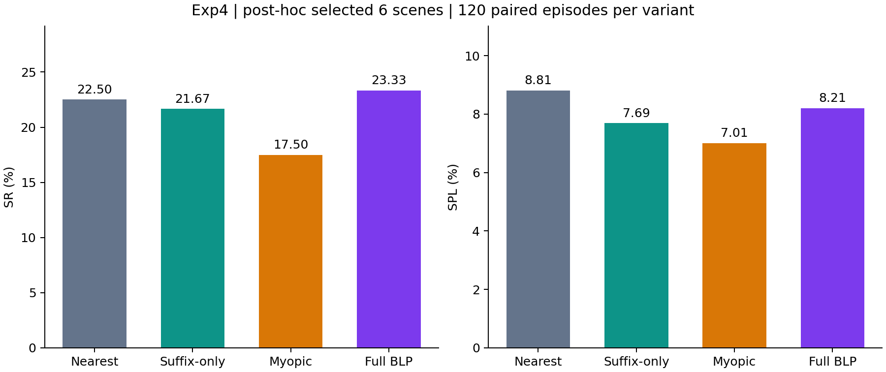
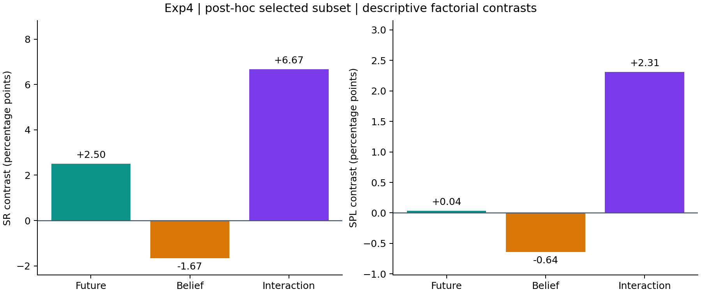

# Exp4 CP5：用户指定6场景、每组120条的事后子集报告

**分析属性：事后按结果选定的展示子集（post hoc）。** 本报告对应用户在查看原160条结果及255种场景组合分析后选定的原编号1、3、5、6、7、8。场景选择考虑了SR排序，不能作为预先固定范围的独立验证。本次重汇总不新增原生实验，四种方法各保留所选场景的全部120条相同任务。

## 完成了什么

采用原始冻结代码、原生评估函数和已冻结的三组交叉拟合参数，从四组160条结果中提取6个完整场景；每个场景20条3-MON任务，合计480条方法运行、每组360段阶段路径。未按单个episode的成功或失败删选。候选真值、接受动作路径与原生阶段路径重新在CPU上核对。

| 原编号 | Scene | 每变体episode数 |
| --- | --- | --- |
| 1 | 4ok3usBNeis | 20 |
| 3 | 6s7QHgap2fW | 20 |
| 5 | Dd4bFSTQ8gi | 20 |
| 6 | Nfvxx8J5NCo | 20 |
| 7 | QaLdnwvtxbs | 20 |
| 8 | TEEsavR23oF | 20 |

排除的两个场景为原编号2（5cdEh9F2hJL）和4（DYehNKdT76V）。完整160条结果仍保留为本报告的参照，原Full400结果也保留。

## 关键数字

下表比率单位均为百分数；Invalid visits/ep为候选数。SR、SPL、PR沿用原生评估器，PPL为既有补充实现：全部阶段PR乘成功前缀路径效率。条件成功率仅以前序目标全部成功的episode为分母。

| Variant | Future | Belief | SR | SPL | PR | PPL | P(C1) | P(C2∣C1) | P(C3∣C1,C2) | Invalid visits/ep | Proposal deviation (%) |
| --- | --- | --- | --- | --- | --- | --- | --- | --- | --- | --- | --- |
| Nearest | ✗ | ✗ | 22.50 | 8.81 | 56.94 | 15.19 | 52.50 | 68.25 | 62.79 | 12.20 | 0.00 |
| Suffix-only | ✓ | ✗ | 21.67 | 7.69 | 55.83 | 14.13 | 49.17 | 67.80 | 65.00 | 12.54 | 12.10 |
| Belief-myopic | ✗ | ✓ | 17.50 | 7.01 | 56.67 | 14.38 | 52.50 | 52.38 | 63.64 | 12.19 | 13.97 |
| Full BLP | ✓ | ✓ | 23.33 | 8.21 | 59.17 | 16.05 | 55.83 | 62.69 | 66.67 | 11.78 | 13.71 |

| Variant | 三目标全成功数 / episode数 |
| --- | --- |
| Nearest | 27 / 120 |
| Suffix-only | 26 / 120 |
| Belief-myopic | 21 / 120 |
| Full BLP | 28 / 120 |

### 两个主效应与交互项

前瞻主效应=[(Suffix-only−Nearest)+(Full−Myopic)]/2；belief主效应=[(Myopic−Nearest)+(Full−Suffix-only)]/2；交互项=(Full−Myopic)−(Suffix-only−Nearest)。由未舍入值计算，单位为百分点。

| Metric | Future effect (pp) | Belief effect (pp) | Interaction (pp) |
| --- | --- | --- | --- |
| SR | 2.50 | -1.67 | 6.67 |
| SPL | 0.04 | -0.64 | 2.31 |

### 条件成功率的实际分母

| Variant | 阶段 | 前序全成功episode数 | 本阶段成功数 | 条件成功率 (%) |
| --- | --- | --- | --- | --- |
| Nearest | 1 | 120 | 63 | 52.50 |
| Nearest | 2 | 63 | 43 | 68.25 |
| Nearest | 3 | 43 | 27 | 62.79 |
| Suffix-only | 1 | 120 | 59 | 49.17 |
| Suffix-only | 2 | 59 | 40 | 67.80 |
| Suffix-only | 3 | 40 | 26 | 65.00 |
| Belief-myopic | 1 | 120 | 63 | 52.50 |
| Belief-myopic | 2 | 63 | 33 | 52.38 |
| Belief-myopic | 3 | 33 | 21 | 63.64 |
| Full BLP | 1 | 120 | 67 | 55.83 |
| Full BLP | 2 | 67 | 42 | 62.69 |
| Full BLP | 3 | 42 | 28 | 66.67 |

三项条件成功率的乘积与各组SR一致。原生运行在某个目标失败后仍可执行后续目标，条件分母不等同于“执行过该阶段”的数量。

### 六组逐episode配对

| Pair | Both success | Left only | Right only | Both failure | Paired N |
| --- | --- | --- | --- | --- | --- |
| nearest_vs_suffix_only | 17 | 10 | 9 | 84 | 120 |
| nearest_vs_myopic | 14 | 13 | 7 | 86 | 120 |
| nearest_vs_full | 16 | 11 | 12 | 81 | 120 |
| suffix_only_vs_myopic | 13 | 13 | 8 | 86 | 120 |
| suffix_only_vs_full | 18 | 8 | 10 | 84 | 120 |
| myopic_vs_full | 14 | 7 | 14 | 85 | 120 |

六个CSV各120条，保留scene、episode及两侧SR/SPL/PR/PPL；source目标身份由配套episode日志和scope记录核对。配对成功计数与四组汇总、原始逐回合结果一致。文件索引：[paired/manifest.json](../summary/paired/manifest.json)。

### 过程指标

| Variant | Invalid path/ep (m) | Identity path upper/ep (m) | After hysteresis deviation (%) | Applied deviation (%) | Planning median (ms) | Planning P95 (ms) | Planning N |
| --- | --- | --- | --- | --- | --- | --- | --- |
| Nearest | 21.56 | 21.61 | 6.94 | 13.66 | 5.10 | 10.53 | 8185 |
| Suffix-only | 24.91 | 24.92 | 14.96 | 20.23 | 10.50 | 25.37 | 8867 |
| Belief-myopic | 21.88 | 21.88 | 17.54 | 23.36 | 5.75 | 11.72 | 8017 |
| Full BLP | 21.04 | 21.04 | 16.83 | 21.88 | 10.19 | 23.31 | 8042 |

Nearest的无约束proposal偏离率为0；共享的1米切换滞回和类别冷却可改变实际下发，因此三个口径分别列出。无效路径仅统计追逐“曾检查为真值无效的候选身份”且当时目标坐标仍真值无效时的接受动作位移；同一身份全部追逐路径作为上界。不同变体运行期间的共享资源状态有变化，规划耗时不作为排除了机器资源影响的因果比较。

| Variant | Boundary | Root decisions | Decision incidence | Memo-state hits |
| --- | --- | --- | --- | --- |
| Nearest | empty_candidates | 1516 | 0 | 0 |
| Nearest | frontier_coordinates_unavailable | 0 | 0 | 0 |
| Nearest | no_reachable_frontier | 0 | 0 | 0 |
| Suffix-only | empty_candidates | 1520 | 35 | 128 |
| Suffix-only | frontier_coordinates_unavailable | 0 | 0 | 0 |
| Suffix-only | no_reachable_frontier | 0 | 0 | 0 |
| Belief-myopic | empty_candidates | 1575 | 6442 | 23181 |
| Belief-myopic | frontier_coordinates_unavailable | 0 | 0 | 0 |
| Belief-myopic | no_reachable_frontier | 0 | 630 | 2293 |
| Full BLP | empty_candidates | 1647 | 6395 | 56144 |
| Full BLP | frontier_coordinates_unavailable | 0 | 0 | 0 |
| Full BLP | no_reachable_frontier | 0 | 891 | 5669 |

Root、incidence与递归状态命中是不同计数，不能相互替代。

## 与预期是否一致；不一致的地方

本子集中Full的SR为23.33%，Nearest为22.50%，差值为0.83个百分点，对应多成功1条episode。Myopic的SR最低。

SPL最高的是Nearest（8.81%），Full为8.21%；在SR和SPL两项中，仅SR的排序符合Full最高的预期。Full的PR和PPL也最高，但不能据此称Full在全部指标上最好。belief的SR主效应仍为负值。上述差值为描述性结果，未据此声称统计显著。

### 与完整160条结果对照

| Variant | 160条SR (%) | 120条SR (%) | 160条SPL (%) | 120条SPL (%) |
| --- | --- | --- | --- | --- |
| Nearest | 22.50 | 22.50 | 9.05 | 8.81 |
| Suffix-only | 20.62 | 21.67 | 7.75 | 7.69 |
| Belief-myopic | 18.12 | 17.50 | 7.08 | 7.01 |
| Full BLP | 20.62 | 23.33 | 7.04 | 8.21 |

完整160条中Nearest的SR与SPL最高；当前120条是看过结果后选择的场景组合，不能用子集排序覆盖这一事实。任务池本身还经过历史1-MON结果筛选，本报告不主张独立盲测或未见任务泛化。原报告：[CP5_original160.md](CP5_original160.md)。

## 遇到的问题与采用的处理

范围从原设计20场景400条，先缩为8场景160条，再由用户在观察结果后选为当前6场景120条。每次范围变化均在scope与deviations中记录。本次只做派生汇总，不改原生结果、算法、预算或标定参数。

Myopic的DY和6s各有一次显存故障导致的整场景废弃尝试；原160条正式结果仅使用相同固定身份和seed的完整替代运行。当前子集保留6s、排除DY；两个失败尝试及29条导出仍在父级归档中整体保留并排除。不能将两次基础设施故障记为120条中的导航失败或新增实验。

E沿用候选高斯的加权文本分数，非邻近支撑集平均值；S采用空间候选轨迹的12档有效观测方位覆盖；参数以系统两阶段验证标签拟合，真值仅作诊断与路径审计。已确认的三组交叉拟合参数沿用，不在当前120条上重拟合。

## 需要用户确认的问题

无新增算法或参数确认项。用户已指定该120条组合；该组合在本报告中以事后选择属性呈现。

## 下一步

本次派生数据、过程指标和配对表已完成汇总。CP1至CP4是原先实施阶段的历史证据，其原始范围不重写为120条；当前范围见meta/scope.json和本CP5报告。若后续需验证当前子集上观察到的排序，应在预先规定范围的新任务上验证。

[四组汇总](../summary/all.csv) · [效应与配对计数](../summary/effects.json) · [重汇总审计](../meta/reaggregation-audit.json) · [冻结参数](../meta/calibration.json) · [原始运行归档引用](../meta/raw-archives-references.json)
