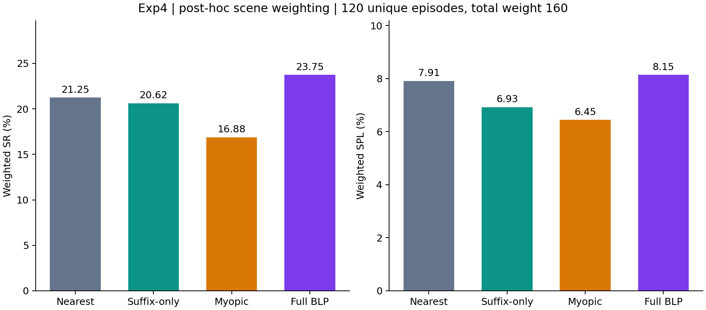
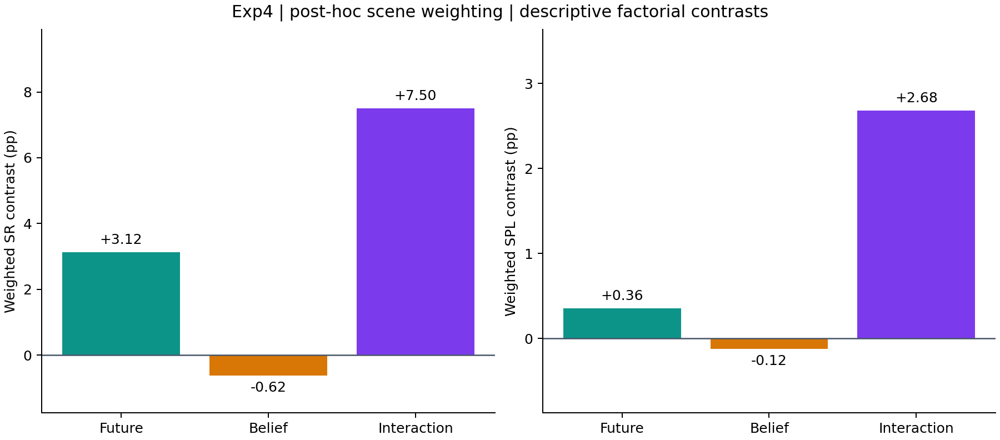

# Exp4 场景加权消融分析报告

生成日期：2026年11月15日。

**分析类型：事后场景加权的描述性分析。** 用户在查看原160条结果、255种场景子集以及选定120条的结果后，指定scene 5、6各计两次。本报告将其实现为权重2，其余所选场景权重1。每个变体仍只有120条唯一任务、6个唯一场景，episode权重和为160；没有新增仿真或独立样本。

## 完成了什么

本报告比较Nearest、Suffix-only、Belief-myopic和Full BLP。四组使用相同的120条3-MON任务、目标顺序、原生指标、冻结算法及交叉拟合参数，统一应用同一组场景权重。每条episode在日志中只出现一次，并附analysis_scene_weight字段；配对CSV使用scene_weight字段。

| 原场景编号 | Scene | 唯一episode数/变体 | 权重 | episode权重贡献 |
| --- | --- | --- | --- | --- |
| 1 | 4ok3usBNeis | 20 | 1 | 20 |
| 3 | 6s7QHgap2fW | 20 | 1 | 20 |
| 5 | Dd4bFSTQ8gi | 20 | 2 | 40 |
| 6 | Nfvxx8J5NCo | 20 | 2 | 40 |
| 7 | QaLdnwvtxbs | 20 | 1 | 20 |
| 8 | TEEsavR23oF | 20 | 1 | 20 |

组合写法为1＋3＋5＋5＋6＋6＋7＋8。scene 5和6各占加权汇总的25%，其余各占12.5%。480条真实方法运行（4×120）没有变为640条新运行。

## 计算方法

对任一变体v和逐episode指标m，加权指标=100×Σ[w(scene_e)×m(v,e)]/Σw(scene_e)，其中分母为160。SR、SPL和PR直接读取已核查原生逐episode结果；PPL沿用原报告的补充实现（全部阶段PR乘成功前缀路径效率）。所有排序与效应使用未舍入值，表格保留两位小数并沿用原报告舍入口径。

条件成功率使用带相同场景权重的成功分子和前序成功分母，不能对已算好的场景条件率简单平均。无效访问和路径按场景加权累计后除以160；偏离率按加权决策/派发分母计算；规划中位数和P95按原始决策耗时的整数频数权重计算。重复权重不增加真实决策计时数量。

Nearest只使用当前测地距离；Suffix-only启用未来代价、令belief为1；Belief-myopic启用belief与当前目标失败分支，关闭未来目标价值；Full使用完整递归。参数继承三组交叉拟合方案，不在此子集重新拟合。E沿用候选高斯的加权文本分数，S为候选轨迹12档有效观测方位覆盖。

## 关键数字

以下导航指标与过程指标均为当前权重下的汇总；比率单位为%，无效访问为每单位episode权重的均值。

| Variant | Future | Belief | Weighted SR | Weighted SPL | Weighted PR | Weighted PPL | Weighted P(C1) | Weighted P(C2∣C1) | Weighted P(C3∣C1,C2) | Weighted invalid visits | Proposal deviation (%) |
| --- | --- | --- | --- | --- | --- | --- | --- | --- | --- | --- | --- |
| Nearest | ✗ | ✗ | 21.25 | 7.91 | 56.67 | 14.17 | 50.62 | 69.14 | 60.71 | 11.88 | 0.00 |
| Suffix-only | ✓ | ✗ | 20.62 | 6.93 | 55.42 | 13.17 | 46.88 | 66.67 | 66.00 | 12.44 | 12.22 |
| Belief-myopic | ✗ | ✓ | 16.88 | 6.45 | 56.88 | 13.70 | 50.62 | 51.85 | 64.29 | 11.95 | 14.21 |
| Full BLP | ✓ | ✓ | 23.75 | 8.15 | 60.62 | 16.06 | 56.25 | 62.22 | 67.86 | 11.40 | 14.19 |

| Variant | 唯一任务中的全成功数 | 成功指示值的加权和 | 唯一任务数 | episode权重和 |
| --- | --- | --- | --- | --- |
| Nearest | 27 | 34 | 120 | 160 |
| Suffix-only | 26 | 33 | 120 | 160 |
| Belief-myopic | 21 | 27 | 120 | 160 |
| Full BLP | 28 | 38 | 120 | 160 |

例如Full的38是成功指示值的加权和；真实唯一成功episode数仍为28。不得把38写成38条不同任务成功。

### 前瞻、belief主效应与交互项

前瞻主效应=[(Suffix-only−Nearest)+(Full−Myopic)]/2；belief主效应=[(Myopic−Nearest)+(Full−Suffix-only)]/2；交互项=(Full−Myopic)−(Suffix-only−Nearest)。单位为百分点。

| Metric | Future effect | Belief effect | Interaction |
| --- | --- | --- | --- |
| SR | 3.12 | -0.62 | 7.50 |
| SPL | 0.36 | -0.12 | 2.68 |

这些效应描述当前权重对应的任务分布。belief单独的主效应仍为负值，交互项为正值，不能把该表解释为两个模块均有独立正收益。

### 条件成功率分子与分母

| Variant | 阶段 | 加权前序成功分母 | 加权本阶段成功分子 | 条件成功率 (%) |
| --- | --- | --- | --- | --- |
| Nearest | 1 | 160 | 81 | 50.62 |
| Nearest | 2 | 81 | 56 | 69.14 |
| Nearest | 3 | 56 | 34 | 60.71 |
| Suffix-only | 1 | 160 | 75 | 46.88 |
| Suffix-only | 2 | 75 | 50 | 66.67 |
| Suffix-only | 3 | 50 | 33 | 66.00 |
| Belief-myopic | 1 | 160 | 81 | 50.62 |
| Belief-myopic | 2 | 81 | 42 | 51.85 |
| Belief-myopic | 3 | 42 | 27 | 64.29 |
| Full BLP | 1 | 160 | 90 | 56.25 |
| Full BLP | 2 | 90 | 56 | 62.22 |
| Full BLP | 3 | 56 | 38 | 67.86 |

未舍入的三项条件成功率乘积与加权SR一致。分母为权重和，不是新增的唯一任务数量。原生系统在前一目标失败后仍可执行后续目标；条件成功率只统计前序全成功者。

### 六组配对：唯一任务计数

| Pair | 都成功 | 仅左成功 | 仅右成功 | 都失败 | 唯一配对数 |
| --- | --- | --- | --- | --- | --- |
| nearest_vs_suffix_only | 17 | 10 | 9 | 84 | 120 |
| nearest_vs_myopic | 14 | 13 | 7 | 86 | 120 |
| nearest_vs_full | 16 | 11 | 12 | 81 | 120 |
| suffix_only_vs_myopic | 13 | 13 | 8 | 86 | 120 |
| suffix_only_vs_full | 18 | 8 | 10 | 84 | 120 |
| myopic_vs_full | 14 | 7 | 14 | 85 | 120 |

### 相同配对的加权成功指示值和

| Pair | 都成功权重和 | 仅左权重和 | 仅右权重和 | 都失败权重和 | 总权重 |
| --- | --- | --- | --- | --- | --- |
| nearest_vs_suffix_only | 20 | 14 | 13 | 113 | 160 |
| nearest_vs_myopic | 16 | 18 | 11 | 115 | 160 |
| nearest_vs_full | 19 | 15 | 19 | 107 | 160 |
| suffix_only_vs_myopic | 15 | 18 | 12 | 115 | 160 |
| suffix_only_vs_full | 21 | 12 | 17 | 110 | 160 |
| myopic_vs_full | 18 | 9 | 20 | 113 | 160 |

每份配对CSV只保存120行唯一配对，显式记录scene_weight。加权计数只能用于上表的描述性汇总，不能作为160个独立配对用于显著性检验。

### 加权过程指标

| Variant | Invalid path/weight unit (m) | Identity path upper/weight unit (m) | After hysteresis deviation (%) | Applied deviation (%) | Weighted planning median (ms) | Weighted planning P95 (ms) | 真实决策行数 | 决策权重和 |
| --- | --- | --- | --- | --- | --- | --- | --- | --- |
| Nearest | 20.61 | 20.64 | 7.62 | 14.47 | 5.31 | 10.86 | 8185 | 10604 |
| Suffix-only | 25.51 | 25.52 | 15.04 | 20.22 | 10.90 | 25.98 | 8867 | 11791 |
| Belief-myopic | 21.23 | 21.23 | 17.80 | 23.69 | 6.10 | 12.20 | 8017 | 10297 |
| Full BLP | 20.23 | 20.24 | 17.29 | 22.41 | 10.62 | 23.21 | 8042 | 10266 |

Nearest的proposal偏离率为0；共享1米滞回和类别冷却可改变最终实际派发，所以滞回后与实际下发偏离率单列。无效路径使用原来的接受动作目标归因和原生GT口径；scene 5、6的过程汇总已用冻结分析函数重新在CPU上核查。不同变体运行时共享机器资源有变化，加权耗时不代表新计时实验或资源隔离下的速度收益。

| Variant | Boundary | 加权Root decisions | 加权Decision incidence | 加权Memo-state hits |
| --- | --- | --- | --- | --- |
| Nearest | empty_candidates | 1995 | 0 | 0 |
| Nearest | frontier_coordinates_unavailable | 0 | 0 | 0 |
| Nearest | no_reachable_frontier | 0 | 0 | 0 |
| Suffix-only | empty_candidates | 2061 | 41 | 148 |
| Suffix-only | frontier_coordinates_unavailable | 0 | 0 | 0 |
| Suffix-only | no_reachable_frontier | 0 | 0 | 0 |
| Belief-myopic | empty_candidates | 1973 | 8324 | 30001 |
| Belief-myopic | frontier_coordinates_unavailable | 0 | 0 | 0 |
| Belief-myopic | no_reachable_frontier | 0 | 654 | 2380 |
| Full BLP | empty_candidates | 2083 | 8183 | 72062 |
| Full BLP | frontier_coordinates_unavailable | 0 | 0 | 0 |
| Full BLP | no_reachable_frontier | 0 | 935 | 5960 |

回退的根决策数、涉及该回退的决策数和递归状态命中数含义不同，不能互相替代。上表同样是权重和。

## 与预期是否一致；不一致的地方

在所指定权重下，Full的加权SR、SPL、PR、PPL均为四组最高。Full相对Nearest的SR差值为2.50个百分点，SPL差值为0.24个百分点。Myopic的加权SR和SPL最低；Nearest不是最低。

### 与未加权结果对照

| Variant | 原8场景160唯一任务 SR/SPL | 选定6场景120唯一任务 SR/SPL | 相同120任务加权 SR/SPL |
| --- | --- | --- | --- |
| Nearest | 22.50 / 9.05 | 22.50 / 8.81 | 21.25 / 7.91 |
| Suffix-only | 20.62 / 7.75 | 21.67 / 7.69 | 20.62 / 6.93 |
| Belief-myopic | 18.12 / 7.08 | 17.50 / 7.01 | 16.88 / 6.45 |
| Full BLP | 20.62 / 7.04 | 23.33 / 8.21 | 23.75 / 8.15 |

原8场景中Nearest的SR和SPL最高；选定6场景未加权时Full的SR最高、Nearest的SPL最高；增加scene 5、6的权重后，当前加权表中Full的SR与SPL均最高。这个变化来自评估场景及其权重的事后选择。原任务池还经过历史1-MON结果筛选，因此不据此声称独立盲测或未见任务泛化。

## 遇到的问题与采用的处理

用户指定scene 5、6重复计入，本报告将“重复”落实为显式权重，原始任务身份和指标值不变，每条记录只存一次。所有方法使用相同权重，未按单个episode的成功或失败删选。代码、参数、预算、原160/400条归档和此前120条未加权报告均保留。

三组交叉拟合参数、两阶段验证口径、候选级观测覆盖及共享滞回机制均继承既有版本。Myopic的两次基础设施失败尝试仍按父报告整体排除；当前表使用已核查的正式运行。

## 结论及适用范围

本次报告给出用户指定场景权重下的描述性消融结果。Full在该加权分布上的四项导航指标最高；该结果不能作为在完整评估分布上稳定优于Nearest的证据，也不提供独立统计显著性结论。唯一任务数始终为120，权重和160只用于计算加权均值。

## 交付物与可复现性

[权重与范围](../meta/scope.json)、[四组加权汇总CSV](../summary/all_weighted.csv)、[效应与双口径配对计数](../summary/effects.json)、[配对CSV索引](../summary/paired/manifest.json)、[重加权审计](../meta/reweighting-audit.json)。逐episode日志保存120条唯一记录及analysis_scene_weight字段。

[原120条报告](https://github.com/pieceHk/ForesightNav/blob/f1b60a75c4ad1694e2d85d5fec44baf3d370037c/results/exp4/scopes/selected6-posthoc-20261115/reports/CP5.md)、[冻结参数](https://github.com/pieceHk/ForesightNav/blob/f1b60a75c4ad1694e2d85d5fec44baf3d370037c/results/exp4/scopes/selected6-posthoc-20261115/meta/calibration.json)、[原8场景160条报告](https://github.com/pieceHk/ForesightNav/blob/391d7e25b12171144a77cfbc41f220efe11294fb/results/exp4/scopes/first8/reports/CP5.md)。

